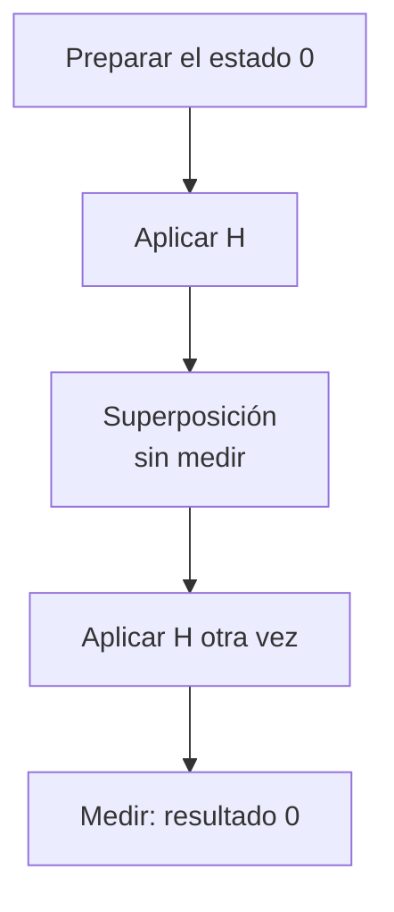

import { Quiz } from "@/components/quiz";

Una **puerta cuántica** transforma el estado de uno o varios [cúbits](/articulos/que-es-un-cubit/). En el modelo ideal de puertas **unitarias**, la transformación es reversible y conserva la suma de probabilidades. La **interferencia** aparece cuando contribuciones a una amplitud se refuerzan o se cancelan al aplicar esas operaciones.

Medir es otra operación: produce información clásica y no es, en general, reversible. No se debe insertar una medición como si solo imprimiera una variable para observarla sin consecuencias.

## Trabajar con amplitudes, no solo con probabilidades

Representaremos un estado puro de un cúbit mediante `[a, b]`: amplitudes de `|0⟩` y `|1⟩`. Para mantener las cuentas pequeñas, usaremos amplitudes reales. En el modelo general pueden ser complejas.

Una puerta recibe esas amplitudes y calcula otras. Solo después, al preguntar por una medición en la base computacional, elevamos al cuadrado sus módulos para obtener probabilidades.

## X: intercambiar las amplitudes

La puerta **X** transforma `[a, b]` en `[b, a]`. Si el estado era `[1, 0]`, que representa `|0⟩`, pasa a `[0, 1]`, que representa `|1⟩`. Aplicarla otra vez devuelve el estado inicial.

En esos dos estados recuerda a la [puerta NOT](/articulos/puertas-logicas/), pero X también actúa sobre superposiciones: `[0.6, 0.8]` pasa a `[0.8, 0.6]`. Las probabilidades intercambian sus valores, de 0,36/0,64 a 0,64/0,36.

## H: sumar y restar

La puerta **Hadamard**, abreviada H, aplica estas reglas:

- Nueva amplitud de 0: `(a + b) / √2`.
- Nueva amplitud de 1: `(a - b) / √2`.

`√2` es la raíz cuadrada de dos, aproximadamente 1,414. Esa división mantiene la normalización: si los módulos al cuadrado sumaban uno, las nuevas amplitudes también cumplen la condición.

Partiendo de `[1, 0]`, las dos amplitudes quedan en `1/√2`, aproximadamente 0,707. Medir entonces daría 0 o 1 con probabilidad de un medio.

Pero **H no significa «sortear un bit»**. Si aplicamos otra H sin medir entre medias:

| Amplitud final | Cuenta |
| --- | --- |
| De 0 | `(1/√2 + 1/√2) / √2 = 1` |
| De 1 | `(1/√2 - 1/√2) / √2 = 0` |

La primera contribución se refuerza; la segunda se cancela. Medir al final da 0 con certeza en este modelo ideal.



## Seguir el cálculo con JavaScript

Este código simula las fórmulas con números clásicos. No ejecuta puertas físicas ni simula ruido:

```js
const x = ([a, b]) => [b, a];
const h = ([a, b]) => [(a + b) / Math.SQRT2, (a - b) / Math.SQRT2];
const z = ([a, b]) => [a, -b];
const probabilidades = (estado) =>
	estado.map((a) => (a * a).toFixed(2)).join(" ");

console.log(probabilidades(x([0.6, 0.8]))); // "0.64 0.36"
console.log(probabilidades(h([1, 0]))); // "0.50 0.50"
console.log(probabilidades(h(h([1, 0])))); // "1.00 0.00"
console.log(probabilidades(h(z(h([1, 0]))))); // "0.00 1.00"
```

La puerta **Z** cambia el signo de la amplitud de 1. Colocarla entre las dos H invierte el resultado final: ahora se cancela la amplitud de 0. Antes de la última H, las probabilidades seguían siendo 0,5/0,5; el signo relativo era diferente. Esa información de **fase relativa** importa aunque una medición inmediata no la distinga.

## Qué cambia si medimos en medio

Tras la primera H, una medición en la base computacional deja `|0⟩` o `|1⟩`, cada uno con probabilidad de un medio. La segunda H actúa sobre ese estado ya medido:

- H sobre `|0⟩` da amplitudes `[1/√2, 1/√2]`.
- H sobre `|1⟩` da `[1/√2, -1/√2]`.

Ambos casos dan 0 y 1 con probabilidades iguales al medir al final. Hemos perdido el resultado determinista de dos H seguidas: registrar el resultado intermedio cambió el experimento.

<Quiz
	client:visible
	question="Se prepara 0 y se aplican dos H ideales, sin medir entre ellas. ¿Qué se obtiene al medir al final?"
	options={[
		"0 con certeza por la combinación de amplitudes",
		"0 y 1 siempre a partes iguales, porque H sortea un bit",
		"Las dos amplitudes originales como salida clásica",
	]}
	answer={0}
/>

## Para qué sirve esta distinción

Un **circuito cuántico** organiza puertas y mediciones en una secuencia. El algoritmo debe crear interferencias relacionadas con el problema que intenta resolver. Añadir superposiciones no basta para obtener la respuesta correcta ni una ventaja de velocidad.

Estos cálculos de un solo cúbit son pequeños y fáciles de simular en un ordenador clásico. Su propósito es entender el mecanismo. Las puertas sobre varios cúbits pueden crear [entrelazamiento](/articulos/entrelazamiento-cuantico/), que requiere seguir el estado conjunto.

## Lo esencial

- Las puertas unitarias transforman amplitudes de forma reversible en el modelo ideal.
- H combina amplitudes; no equivale a lanzar una moneda.
- Dos H se cancelan entre sí, pero una medición intermedia cambia el resultado.
- La fase relativa puede cambiar una predicción posterior aunque las probabilidades inmediatas sean iguales.
