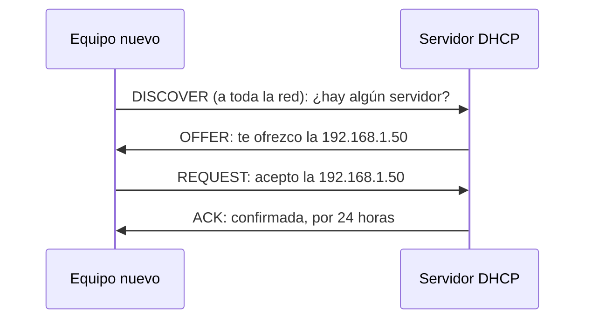

import { Quiz } from "@/components/quiz";

**DHCP**, protocolo de configuración dinámica de equipos, es el que hace que un dispositivo funcione en una red nada más conectarse. Al unirse a una wifi o enchufar un cable, el equipo pide a un **servidor DHCP**, normalmente el router, todo lo que necesita: su [dirección IP](/articulos/que-es-una-direccion-ip/), la máscara de [subred](/articulos/subredes-y-cidr/), la [puerta de enlace](/articulos/puerta-de-enlace-predeterminada/) y los servidores [DNS](/articulos/que-es-dns/).

Sin DHCP, habría que escribir todo eso a mano en cada dispositivo, y evitar que dos usaran la misma IP.

## Los cuatro mensajes

El intercambio básico tiene cuatro pasos, que se recuerdan por sus iniciales en inglés, **DORA**:

1. **Discover**: el equipo, que aún no tiene dirección, envía un mensaje de difusión para localizar servidores.
2. **Offer**: un servidor responde ofreciendo una configuración.
3. **Request**: el equipo pide la configuración ofrecida, y con ello rechaza implícitamente otras ofertas.
4. **Ack**: el servidor la confirma.

Los mensajes viajan por [UDP](/articulos/tcp-y-udp/), porque el equipo todavía no tiene una dirección con la que establecer una conexión.

## El arrendamiento

DHCP no regala las direcciones: las **presta** durante un tiempo, el **arrendamiento** (*lease*). Antes de que caduque, el equipo pide renovarlo. Si se desconecta y no lo renueva, la dirección vuelve a quedar libre para otro. Así un router con 200 direcciones atiende a muchos más dispositivos que entran y salen.

## Direcciones fijas

Algunos equipos necesitan siempre la misma IP, como una impresora o un servidor. Hay dos formas:

- **Reserva en el servidor DHCP**: siempre le da la misma IP a esa [dirección MAC](/articulos/que-es-una-direccion-mac/).
- **Configuración estática** en el propio equipo, fuera del rango que reparte el servidor.

## Problemas típicos

- **Sin respuesta del servidor**: el equipo se queda sin dirección válida, o con una que solo sirve dentro de la red local, y no llega a internet. Suele bastar con reiniciar la conexión o el router.
- **Dos servidores DHCP** en la misma red, por ejemplo un router añadido sin desactivar el suyo, reparten configuraciones distintas y provocan fallos intermitentes.
- **Un servidor DHCP malicioso**: DHCP no autentica al servidor, así que en una red sin proteger alguien podría responder antes que el router y anunciarse como puerta de enlace.

## Lo esencial

- DHCP configura automáticamente IP, máscara, puerta de enlace y DNS al conectarse a una red.
- El intercambio tiene cuatro mensajes: Discover, Offer, Request y Ack.
- Las direcciones se prestan por un tiempo y se renuevan.
- Una reserva en el servidor garantiza la misma IP a un equipo concreto.
