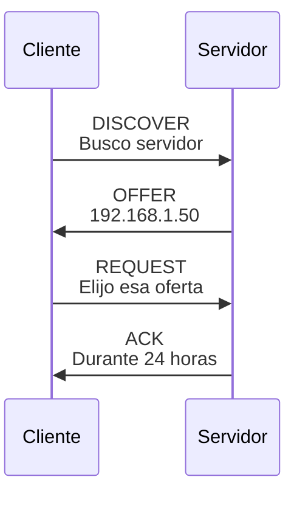

import { Quiz } from "@/components/quiz";

**DHCP**, protocolo de configuración dinámica de equipos, permite obtener parámetros de red sin escribirlos manualmente en cada dispositivo. Aquí tratamos **DHCP para IPv4**: un cliente puede solicitar una [dirección IP](/articulos/que-es-una-direccion-ip/) y recibir además máscara de [subred](/articulos/subredes-y-cidr/), [puerta de enlace](/articulos/puerta-de-enlace-predeterminada/) y servidores [DNS](/articulos/que-es-dns/).

Lo proporciona un [servidor](/articulos/que-es-un-servidor/) DHCP, a menudo integrado en el router doméstico. Conectarse físicamente no garantiza que ese servidor responda ni que la configuración permita acceder a internet.

Centralizar las asignaciones facilita evitar direcciones duplicadas y actualizar parámetros. La configuración manual sigue siendo posible. IPv6 tiene mecanismos distintos, como SLAAC y DHCPv6; no toda asignación automática es este intercambio de cuatro mensajes.

## Los cuatro mensajes

Una asignación nueva puede seguir cuatro pasos, recordados como **DORA**. Este ejemplo ofrece `192.168.1.50` durante 24 horas; esos valores son una elección de la red, no una exigencia del protocolo:

1. **Discover**: el equipo, que aún no tiene dirección, envía un mensaje de difusión para localizar servidores.
2. **Offer**: un servidor responde ofreciendo una configuración.
3. **Request**: el equipo difunde qué oferta ha seleccionado, identificando al servidor. Los otros servidores saben así que sus ofertas no fueron elegidas.
4. **Ack**: el servidor la confirma.

El protocolo usa [UDP](/articulos/tcp-y-udp/), con los puertos 67 del servidor y 68 del cliente. Admite el descubrimiento mediante difusión incluso antes de disponer de una dirección utilizable. Un **agente de retransmisión** puede llevar las solicitudes a un servidor situado en otra subred; no tiene que vivir siempre dentro del router local.

La oferta no es todavía una concesión confirmada. Tras la confirmación, el cliente debe comprobar posibles conflictos antes de usar la dirección; si detecta uno, puede rechazarla y reiniciar la búsqueda.

<Quiz
	client:visible
	question="Dos servidores ofrecen una configuración. ¿Qué comunica el REQUEST inicial del ejemplo?"
	options={[
		"Qué oferta y servidor ha seleccionado el cliente",
		"Que el cliente quiere utilizar las dos IP a la vez",
		"Que ya no necesita confirmación",
	]}
	answer={0}
/>

## El arrendamiento

Una asignación dinámica dura un **arrendamiento** (*lease*). El cliente intenta renovarlo antes de que caduque. Desconectar el cable no informa necesariamente al servidor de que ya puede reutilizar la dirección: puede seguir reservada hasta su vencimiento o liberación.

Con una concesión de 24 horas y los tiempos predeterminados del protocolo, la secuencia sería:

| Momento | Acción si no se ha renovado |
| --- | --- |
| Inicio | El cliente obtiene la concesión |
| A las 12 horas | Intenta renovar con el servidor que la concedió |
| A las 21 horas | Intenta obtener renovación de cualquier servidor adecuado |
| A las 24 horas | Si no hay renovación, debe dejar de usar esa concesión |

El servidor puede indicar otros tiempos. Una primera renovación sin respuesta no obliga a perder inmediatamente una concesión todavía vigente. Reutilizar direcciones permite atender usuarios que entran y salen, pero no asignar a la vez más direcciones distintas de las disponibles.

## Direcciones fijas

Una dirección estable puede facilitar encontrar una impresora o administrar un servicio. Dos formas de mantenerla son:

- **Reserva en el servidor DHCP**: asocia una dirección a un identificador del cliente, que puede basarse en la [MAC](/articulos/que-es-una-direccion-mac/). Si cambia el identificador o la configuración, la reserva puede dejar de coincidir.
- **Configuración estática** en el propio equipo, fuera del rango que reparte el servidor.

## Problemas típicos

- **Sin respuesta y sin concesión vigente**: puede fallar el servidor, agotarse el conjunto de direcciones o bloquearse el intercambio. Reiniciar no resuelve necesariamente la causa.
- **Servidores mal coordinados**: pueden ofrecer direcciones duplicadas o salidas incompatibles. Tener varios servidores no es por sí solo un error; necesitan una configuración coherente.
- **Una oferta falsa**: el intercambio básico no demuestra que el servidor sea de confianza. Una oferta maliciosa puede anunciar una puerta de enlace o DNS controlados por otra persona.

## Lo esencial

- DHCP configura automáticamente IP, máscara, puerta de enlace y DNS al conectarse a una red.
- Una asignación inicial puede seguir Discover, Offer, Request y Ack; la renovación tiene otro recorrido.
- Las direcciones se prestan por un tiempo y se renuevan.
- Una reserva relaciona una dirección con un identificador del cliente, según la configuración.
