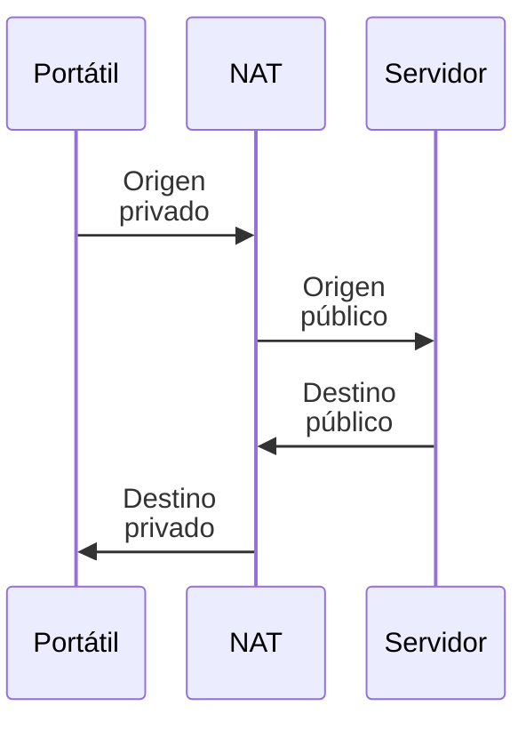

import { Quiz } from "@/components/quiz";

**NAT**, traducción de direcciones de red, modifica direcciones IP al pasar tráfico entre redes. Una variante llamada **NAPT** traduce también puertos y permite compartir una dirección pública entre varios equipos. No todo NAT tiene esa forma: también puede haber traducciones de una dirección a otra sin compartirla entre muchos clientes.

Seguiremos el caso doméstico habitual de NAPT: equipos con IPv4 privadas que salen mediante una dirección pública común.

## El problema que resolvió

IPv4 tiene un espacio limitado. Las [direcciones privadas](/articulos/subredes-y-cidr/), como `192.168.0.0/16` o `10.0.0.0/8`, se pueden reutilizar en distintas organizaciones, pero no se enrutan directamente por la internet pública. NAPT permite salir sin asignar una IPv4 pública propia a cada equipo interno.

## Cómo funciona

Dos portátiles pueden usar el mismo [puerto](/articulos/que-es-un-puerto/) local. El traductor necesita distinguir sus intercambios al recibir respuestas: modifica puertos cuando hace falta y conserva las correspondencias. En este ejemplo inventado, el router utiliza `198.51.100.7` como dirección pública y el servidor `203.0.113.10`; ambas están reservadas para documentación.



En la salida se traduce `192.168.1.20:51000` a `198.51.100.7:40001`; el destino sigue siendo `203.0.113.10:443`. Al volver la respuesta, el destino público se traduce al privado original.

La **tabla de traducciones** permite devolver las respuestas. Esta simulación representa dos conexiones TCP hacia el mismo servidor y puerto. Omite caducidad, filtros, agotamiento de puertos y otras políticas de un traductor real:

```js
const tabla = new Map();
const salidas = new Map();
let siguientePuerto = 40001;

function salir(ipPrivada, puertoPrivado) {
	const origen = `${ipPrivada}:${puertoPrivado}`;
	if (salidas.has(origen)) return salidas.get(origen);
	const puertoPublico = siguientePuerto++;
	const salida = `198.51.100.7:${puertoPublico}`;
	tabla.set(puertoPublico, origen);
	salidas.set(origen, salida);
	return salida;
}

const entrar = (puertoPublico) => tabla.get(puertoPublico) ?? "descartado";

console.log(salir("192.168.1.20", 51000)); // "198.51.100.7:40001"
console.log(salir("192.168.1.31", 51000)); // "198.51.100.7:40002"
console.log(salir("192.168.1.20", 51000)); // "198.51.100.7:40001"
console.log(entrar(40002)); // "192.168.1.31:51000"
console.log(entrar(45000)); // "descartado"
```

El segundo portátil obtiene el puerto público 40002, aunque ambos usan 51000 internamente. El primero reutiliza su correspondencia. En este modelo, un puerto sin entrada no tiene destinatario y se descarta; un equipo real puede tener además reglas estáticas, otros mapeos y filtros.

<Quiz
	client:visible
	question="En la simulación, una respuesta llega al puerto público 40002. ¿A quién se devuelve?"
	options={["192.168.1.20:51000", "192.168.1.31:51000", "A los dos portátiles"]}
	answer={1}
/>

## Consecuencias

- **Una entrada necesita destino.** Sin un mapeo adecuado, el traductor no sabe a qué equipo interno entregar una nueva conexión. Esto no sustituye una política de [cortafuegos](/articulos/cortafuegos/).
- **Redirección de puertos**: para alojar un servicio en casa, se configura a mano una entrada fija, "lo que llegue al puerto 8080, envíalo a 192.168.1.50".
- **Complica la comunicación directa**: llamadas, juegos y [redes P2P](/articulos/redes-peer-to-peer/) pueden necesitar negociación adicional o un intermediario para conectar equipos detrás de traductores.
- **NAT del operador**: algunos operadores aplican otro NAT más, y varios clientes comparten la misma IP pública.

## Y con IPv6

[IPv6](/articulos/ipv4-frente-a-ipv6/) permite asignar direcciones globales sin compartirlas para ahorrar espacio. La política de acceso sigue siendo tarea del cortafuegos, tanto con IPv4 como con IPv6.

En la nube, una pasarela NAT puede proporcionar salida a máquinas de una subred privada de una [VPC](/articulos/nube-privada-virtual/). Rutas, reglas y tipo de pasarela determinan el comportamiento concreto.

## Qué puede fallar

- **Caduca una correspondencia mientras la aplicación sigue esperando.** Un nuevo paquete puede dejar de tener destino interno conocido.
- **Se agotan puertos o capacidad.** Compartir una dirección no permite un número ilimitado de intercambios.
- **Hay NAT del operador.** Configurar una redirección en casa no obliga al traductor del operador a aceptar una conexión entrante.

## Lo esencial

- NAT traduce direcciones; NAPT añade traducción de puertos.
- NAPT permite compartir una IPv4 pública conservando correspondencias para las respuestas.
- Una conexión entrante necesita un mapeo y permisos adecuados.
- Traducir direcciones no cifra los datos ni sustituye un cortafuegos.
