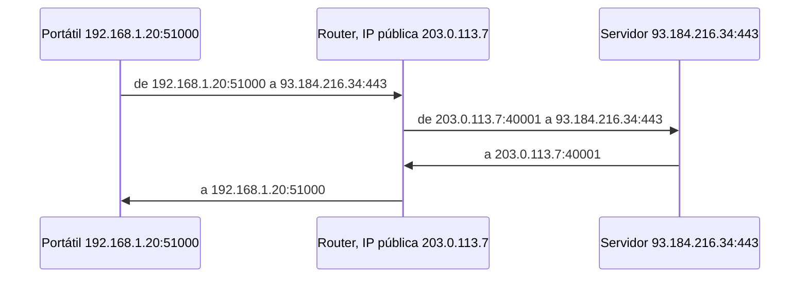

import { Quiz } from "@/components/quiz";

**NAT**, traducción de direcciones de red, es la técnica con la que un router permite que los equipos de una **red privada** se comuniquen con internet usando **una sola dirección IP pública** compartida. El router reescribe las direcciones, y normalmente también los puertos, de los paquetes que pasan por él.

Gracias a NAT, todos los dispositivos de una casa navegan con la única IP pública que da el operador.

## El problema que resolvió

Las direcciones IPv4 son limitadas, unos 4300 millones, y se acabaron. El RFC 1918 reservó unos rangos de **direcciones privadas**, como `192.168.0.0/16` o `10.0.0.0/8`, que cualquiera puede usar dentro de su red pero que no se enrutan por internet, como explica [subredes y CIDR](/articulos/subredes-y-cidr/). NAT es el puente entre esas redes privadas y el exterior.

## Cómo funciona

La forma más común traduce dirección y [puerto](/articulos/que-es-un-puerto/). El RFC 3022 la llama **NAPT**: muchas direcciones privadas y sus puertos TCP o UDP se traducen a una única dirección pública con distintos puertos.



El router guarda una **tabla de traducciones** para saber a quién devolver cada respuesta:

```js
const tabla = new Map();
let siguientePuerto = 40001;

function salir(ipPrivada, puertoPrivado) {
	const puertoPublico = siguientePuerto++;
	tabla.set(puertoPublico, `${ipPrivada}:${puertoPrivado}`);
	return `203.0.113.7:${puertoPublico}`;
}

const entrar = (puertoPublico) => tabla.get(puertoPublico) ?? "descartado";

console.log(salir("192.168.1.20", 51000)); // "203.0.113.7:40001"
console.log(salir("192.168.1.31", 51000)); // "203.0.113.7:40002"
console.log(entrar(40002)); // "192.168.1.31:51000"
console.log(entrar(45000)); // "descartado"
```

Dos equipos usan el mismo puerto privado sin conflicto, porque el router les asigna puertos públicos distintos. Y un paquete que llega a un puerto sin entrada en la tabla se descarta.

## Consecuencias

- **Las conexiones entrantes no llegan solas.** Desde fuera no se puede iniciar una conexión con un equipo de dentro, porque el router no sabe a quién entregarla. Actúa como una barrera, aunque **no es un [cortafuegos](/articulos/cortafuegos/)** y no debe tratarse como tal.
- **Redirección de puertos**: para alojar un servicio en casa, se configura a mano una entrada fija, "lo que llegue al puerto 8080, envíalo a 192.168.1.50".
- **Rompe el modelo de extremo a extremo**: aplicaciones de juegos, llamadas o compartición de archivos necesitan técnicas extra para conectar dos equipos que están detrás de NAT.
- **NAT del operador**: algunos operadores aplican otro NAT más, y varios clientes comparten la misma IP pública.

## Y con IPv6

[IPv6](/articulos/ipv4-frente-a-ipv6/) tiene direcciones de sobra para que cada dispositivo tenga la suya. NAT deja de ser necesario para ahorrar direcciones, y la protección frente a conexiones entrantes pasa a ser tarea explícita del cortafuegos.

En la nube, una pasarela NAT cumple el mismo papel: deja salir a internet a las máquinas de una subred privada de una [VPC](/articulos/nube-privada-virtual/) sin dejarlas accesibles desde fuera.

## Lo esencial

- NAT permite que una red privada comparta una sola IP pública.
- El router reescribe dirección y puerto, y guarda la correspondencia en una tabla.
- Las conexiones iniciadas desde fuera no llegan salvo con redirección de puertos.
- Nació por la escasez de IPv4; con IPv6 deja de ser imprescindible.
