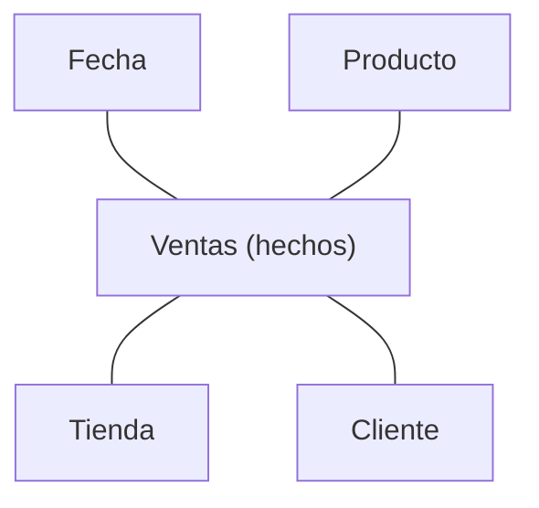

Un **esquema en estrella** es la forma clásica de organizar un [almacén de datos](/articulos/almacen-de-datos-y-lago-de-datos/) para el análisis. Tiene una **tabla de hechos** en el centro, con las cifras que se miden, rodeada de **tablas de dimensiones**, con el contexto por el que se analizan. Dibujado, parece una estrella.



## Las piezas

- **Hechos**: cada suceso que se mide, con sus números. Una fila por venta: importe, unidades.
- **Dimensiones**: el quién, qué, cuándo y dónde. La fecha, con su día, mes y trimestre; el producto, con su categoría; la tienda, con su ciudad y región.

## Por qué así

Muchas preguntas de negocio tienen esta forma: "una cifra, desglosada por algo". Ventas por región y mes; unidades por categoría y tienda.

Antes de consultar hay que fijar el **grano**: qué representa una fila de hechos. Aquí es una venta registrada en una tienda y una fecha. No se mezclan filas de ventas individuales con totales mensuales, porque la suma contaría parte de los importes dos veces.

Este ejemplo completo se ejecuta en una base SQLite nueva. El mes incluye el año para no mezclar octubres de años distintos; los importes están en céntimos:

```sql
PRAGMA foreign_keys = ON;
CREATE TABLE fechas (id INTEGER PRIMARY KEY, dia TEXT NOT NULL, mes TEXT NOT NULL);
CREATE TABLE tiendas (id INTEGER PRIMARY KEY, region TEXT NOT NULL);
CREATE TABLE ventas (
	id INTEGER PRIMARY KEY,
	fecha_id INTEGER NOT NULL REFERENCES fechas(id),
	tienda_id INTEGER NOT NULL REFERENCES tiendas(id),
	importe_centimos INTEGER NOT NULL
);
INSERT INTO fechas VALUES (1, '2026-10-01', '2026-10'), (2, '2026-10-02', '2026-10');
INSERT INTO tiendas VALUES (1, 'norte'), (2, 'sur');
INSERT INTO ventas VALUES (1, 1, 1, 1000), (2, 2, 1, 1500), (3, 2, 2, 700);

SELECT f.mes, t.region, SUM(v.importe_centimos) AS total_centimos
FROM ventas v
JOIN fechas f ON f.id = v.fecha_id
JOIN tiendas t ON t.id = v.tienda_id
GROUP BY f.mes, t.region
ORDER BY f.mes, t.region;
```

El resultado es `2026-10 | norte | 2500` y `2026-10 | sur | 700`. Las claves identifican una sola fila de cada dimensión: si un join duplicara cada venta, el total dejaría de representar esos hechos.

Con el esquema en estrella, cualquiera de esas preguntas es la tabla de hechos unida a las dimensiones que interesan, y agrupada.

## Con qué no confundirlo

Una base de datos operativa, la de [OLTP](/articulos/oltp-y-olap/), se [normaliza](/articulos/normalizacion-de-bases-de-datos/) para evitar repeticiones. Un esquema en estrella suele agrupar atributos de una dimensión en una misma tabla: puede repetir, por ejemplo, el nombre de la región en cada tienda para simplificar los joins. Eso no exige duplicar hechos ni garantiza que cualquier consulta sea más rápida.

Si las dimensiones se normalizan, partiéndolas en varias tablas, el resultado se llama **esquema en copo de nieve**.
