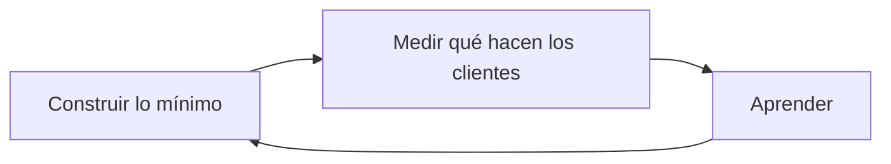

import { Quiz } from "@/components/quiz";

Un **MVP**, producto mínimo viable, es la versión de un producto nuevo que permite **aprender lo máximo** sobre los clientes con el **mínimo esfuerzo**. La idea viene del movimiento Lean Startup: Eric Ries lo definió así, y la Agile Alliance subraya que lo importante no es el producto en sí, sino lo que se **aprende** con él.

## El problema que evita

Pasar un año construyendo un producto completo para descubrir, al lanzarlo, que nadie lo quiere. Con un MVP, esa respuesta llega en semanas.

## Qué es mínimo

La clave es que sea un producto **real**, que se ofrece a clientes reales para observar qué hacen. Según la Agile Alliance, puede ser tan poco como una página de presentación, o un servicio que parece automático pero se hace a mano por detrás. El aprendizaje que se busca es, sobre todo, si los clientes de verdad lo comprarán o usarán.

## Ejemplos de MVP

- Una página que describe el producto y recoge correos de interesados, antes de que exista.
- Un servicio "automático" que en realidad gestiona una persona a mano.
- Una aplicación con una sola función, la que justifica el producto.

## Errores habituales

- **Mínimo, pero no viable**: algo tan pobre que nadie lo usaría, y del que no se aprende nada.
- **Viable, pero no mínimo**: añadir funciones "por si acaso" hasta que deja de ser rápido.
- **No medir**: lanzarlo sin decidir antes qué se quiere aprender y cómo medirlo, por ejemplo con [pruebas A/B](/articulos/pruebas-a-b/).

## Con qué no confundirlo

- **[Prototipo](/articulos/que-es-un-prototipo/)**: sirve para probar una idea de diseño, a menudo sin funcionar de verdad. El MVP se ofrece a clientes reales.
- **Primera versión**: un MVP no es "la versión 1.0 con menos cosas", sino un experimento.

## Lo esencial

- Un MVP es la versión mínima de un producto que permite aprender de clientes reales.
- Busca la máxima información con el menor esfuerzo.
- Puede ser tan sencillo como una página o un servicio hecho a mano por detrás.
