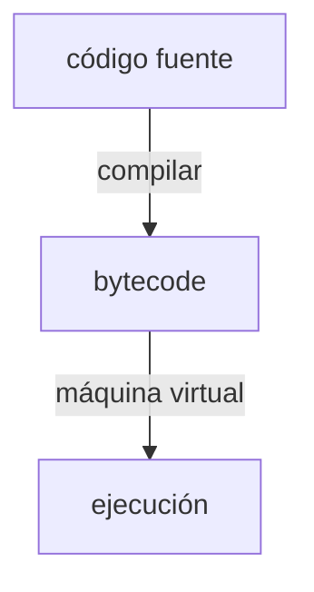

import { Quiz } from "@/components/quiz";

La **máquina virtual de un lenguaje** es un programa que ejecuta un **código intermedio**, llamado a menudo *bytecode*, en lugar del código máquina de un procesador concreto. El compilador del lenguaje produce ese código intermedio, y una máquina virtual compatible lo ejecuta sobre el sistema anfitrión.

Es la idea que Java resumió en su lema: escribir una vez, ejecutar en cualquier sitio.

## Cómo funciona

Un programa en Java se compila a bytecode. El mismo archivo puede funcionar en Windows, Linux o macOS si hay una JVM compatible con su versión y [arquitectura](/articulos/arquitecturas-x86-y-arm/). Bibliotecas nativas, rutas de archivos y APIs específicas pueden limitar esa portabilidad.

## Más rápida de lo que parece

Interpretar el bytecode instrucción a instrucción sería lento. Algunas máquinas virtuales usan **compilación en el momento**, *just in time*: detectan las partes del programa que más se ejecutan y las traducen a código máquina mientras el programa funciona. A menudo el resultado se acerca a la velocidad de un programa compilado.

V8, el motor de JavaScript de Chrome y de [Node.js](/articulos/que-es-nodejs/), hace algo parecido: interpreta al principio y compila lo que se repite.

## Qué más aporta

- **Gestión automática de memoria**, con recolector de basura, como explica [la pila y el montículo](/articulos/pila-y-monticulo-de-memoria/).
- **Comprobaciones de seguridad**, como impedir accesos fuera de un array.
- **Varios lenguajes**: sobre la máquina virtual de Java funcionan también Kotlin o Scala.

## Con qué no confundirla

Una **máquina virtual de sistema**, como las que explica [contenedores y máquinas virtuales](/articulos/contenedores-y-maquinas-virtuales/), simula un ordenador completo para ejecutar otro sistema operativo. La máquina virtual de lenguaje ejecuta su formato de programa; varios lenguajes fuente pueden compilar al mismo formato. Comparten nombre, no propósito.
