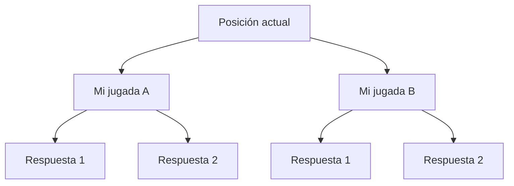

import { Quiz } from "@/components/quiz";

**Deep Blue** fue un superordenador de IBM diseñado para jugar al ajedrez. El 11 de mayo de 1997 se convirtió en la primera máquina que ganaba un enfrentamiento a seis partidas, con ritmo de torneo, al campeón del mundo vigente, **Garry Kasparov**.

## La revancha

No era el primer enfrentamiento: Kasparov había ganado a una versión anterior de Deep Blue en 1996. En la revancha de 1997, de seis partidas, Deep Blue ganó dos, Kasparov una y las otras tres terminaron en tablas.

Crear un programa de ajedrez de nivel de campeón del mundo era un objetivo de los investigadores de inteligencia artificial desde los años cincuenta.

## Cómo jugaba: fuerza bruta

Deep Blue no aprendía como los sistemas actuales. Su fuerza venía, como explica IBM, de la **potencia de cálculo bruta**: evaluaba unos **200 millones de posiciones por segundo**.

La idea es la de recorrer un árbol de posibilidades, como en una [búsqueda en profundidad](/articulos/busqueda-en-anchura-y-en-profundidad/):

1. Desde la posición actual, se generan todas las jugadas posibles, las respuestas del rival a cada una, las respuestas a esas respuestas, y así varios niveles.
2. Las posiciones finales se puntúan con una **función de evaluación**: material, seguridad del rey, control del centro.
3. Se elige la jugada que lleva al mejor resultado suponiendo que el rival también juega lo mejor posible.

El número de posiciones crece de forma exponencial con cada nivel, como explica [complejidad algorítmica](/articulos/complejidad-algoritmica/). Por eso hacía falta hardware especializado para mirar lo bastante lejos.

## Lo que demostró y lo que no

Deep Blue demostró que en un problema bien definido, con reglas fijas, la búsqueda masiva podía superar al mejor humano. No demostró que la máquina "entendiera" el ajedrez: no podía hacer otra cosa que jugar, y su conocimiento lo programaron personas.

Los sistemas que vinieron después siguieron otro camino: aprender a jugar a partir de partidas, con [aprendizaje por refuerzo](/articulos/aprendizaje-por-refuerzo/) y redes neuronales, como explica [inteligencia artificial, aprendizaje automático y profundo](/articulos/inteligencia-artificial-aprendizaje-automatico-y-profundo/).

## Lo esencial

- Deep Blue, de IBM, ganó en 1997 a Garry Kasparov: dos victorias, una derrota y tres tablas.
- Kasparov había ganado a la versión anterior en 1996.
- Jugaba por fuerza bruta: evaluaba unos 200 millones de posiciones por segundo.
- Mostró el poder de la búsqueda masiva en problemas con reglas fijas, no una inteligencia general.
