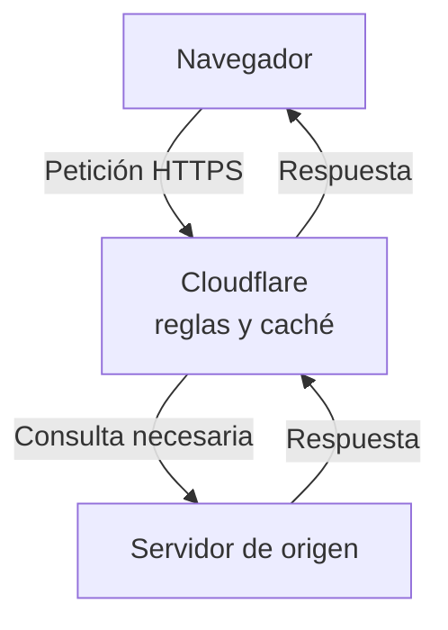

import { Quiz } from "@/components/quiz";

Cloudflare puede actuar como **[proxy inverso](/articulos/proxy-y-proxy-inverso/)**: recibe peticiones dirigidas a una web y responde en nombre de ella. Según el contenido y la configuración, sirve una copia guardada o consulta al **origen**, el servidor que produce la respuesta original.

Seguiremos una web hipotética, `example.com`, cuyo origen está en otro proveedor y cuyo proxy de Cloudflare está activado. Cloudflare ofrece otros servicios; este caso explica la intermediación de una petición web, no todos sus productos.

## El DNS decide por dónde empieza la visita

El navegador necesita una dirección para conectarse. Al consultar [DNS](/articulos/que-es-dns/), obtiene una [IP](/articulos/que-es-una-direccion-ip/):

- Con el registro en modo **proxied**, la respuesta contiene direcciones de Cloudflare. La petición web llega primero a su red.
- En modo **DNS only**, Cloudflare publica el registro DNS, pero no interpone este proxy en la petición. El cliente utiliza la dirección indicada para el origen.

Por tanto, usar Cloudflare para gestionar DNS no demuestra que la web pase por su caché. Tampoco basta con que un visitante use el resolutor público `1.1.1.1`: resolver nombres y recibir el tráfico de una web son funciones diferentes.

## Una petición atraviesa el intermediario

El navegador pide `https://example.com/foto.jpg`. Cloudflare recibe esa petición de [HTTP](/articulos/que-es-http/), interpreta su nombre de sitio y ruta, aplica las reglas configuradas y decide cómo responder.

Una **[caché](/articulos/que-es-una-cache/)** guarda respuestas para reutilizarlas. Si hay una copia adecuada y fresca, puede entregarla sin pedir de nuevo el archivo al origen. Si hace falta consultar al origen, Cloudflare le envía una petición y devuelve su respuesta al navegador. Las copias distribuidas forman parte de su función de **[CDN](/articulos/que-es-una-cdn/)**, red de distribución de contenido.

Este recorrido muestra el caso que necesita contactar con el origen:



El proxy no convierte cualquier respuesta en una copia compartida. La configuración predeterminada de Cloudflare admite ciertas extensiones estáticas y no almacena automáticamente HTML o JSON. También intervienen cabeceras y reglas. Una página con datos privados no debe tratarse como una imagen pública.

## Tres visitas a la misma foto

Supongamos que `foto.jpg` es almacenable, no tiene restricciones adicionales y devuelve:

```http
Cache-Control: public, max-age=60
```

`public` permite su almacenamiento compartido; `max-age` declara una vida de frescura de sesenta segundos. En nuestro ejemplo, la edad inicial es cero y las tres visitas consultan la misma caché, que conserva el archivo. No hay purgas, reglas que cambien el plazo ni permiso para servir una respuesta caducada.

| Momento | Qué sucede |
| --- | --- |
| Segundo 0 | Falta la foto; Cloudflare obtiene la versión A del origen y la guarda |
| Segundo 10 | El propietario sustituye la foto del origen por la versión B |
| Segundo 20 | La copia A sigue fresca y se puede entregar sin consultar al origen |
| Segundo 65 | La copia ya no está fresca; hay que consultar al origen antes de reutilizarla en este caso |

Si el origen confirma un cambio, devuelve B. Si no hubiera cambiado y existiera un validador, podría confirmar la copia mediante `304 Not Modified`, evitando transferir otra vez su cuerpo.

El plazo no obliga a conservar la foto durante sesenta segundos: la caché podría desalojarla antes para liberar espacio. Otra ubicación de la red también puede tener un estado distinto. **Frescura** es cuánto tiempo se permite reutilizar sin comprobar; **retención** es cuánto tiempo permanece guardada.

<Quiz
	client:visible
	question="En el caso explicado, el origen cambia en el segundo 10. ¿Por qué se puede recibir A en el segundo 20?"
	options={[
		"Cloudflare impide modificar el archivo original",
		"La copia conserva frescura según la política elegida",
		"El DNS almacena los píxeles durante sesenta segundos",
	]}
	answer={1}
/>

## HTTPS protege dos tramos

**[TLS](/articulos/https-y-tls/)** protege una conexión mediante cifrado y comprobaciones de autenticidad e integridad. En el modo **Full (strict)**, con acceso HTTPS, hay una conexión protegida entre navegador y Cloudflare y otra entre Cloudflare y el origen. Cloudflare comprueba además el certificado del origen, que vincula su identidad con una clave pública.

Son dos conexiones. Cloudflare termina la primera y puede procesar el contenido antes de usar la segunda: necesita interpretar peticiones y respuestas para aplicar sus reglas. El candado del navegador no significa que únicamente el navegador y el origen puedan verlas.

## Qué ocurre si falla una pieza

Una imagen disponible en caché puede seguir sirviéndose sin consultar al origen mientras las reglas lo permitan. Un resultado que necesita datos nuevos del origen sigue dependiendo de él. El proxy puede reducir trabajo repetido; no inventa el resultado de una consulta que no puede ejecutar.

Asimismo, tener copias no elimina la dependencia del intermediario. Si una configuración impide que la petición llegue a Cloudflare o que este responda, el origen puede estar funcionando y la visita fallar igualmente. Para entender el fallo hay que separar resolución DNS, conexión, decisión del proxy y respuesta del origen.

## Lo esencial

- Con el proxy activado, el visitante se conecta a Cloudflare para acceder a esa web.
- La caché puede evitar consultas al origen; no almacena automáticamente cualquier respuesta.
- Frescura y permanencia en caché son propiedades distintas.
- Full (strict) protege dos conexiones y valida el origen; Cloudflare sigue siendo un intermediario que procesa el tráfico.
