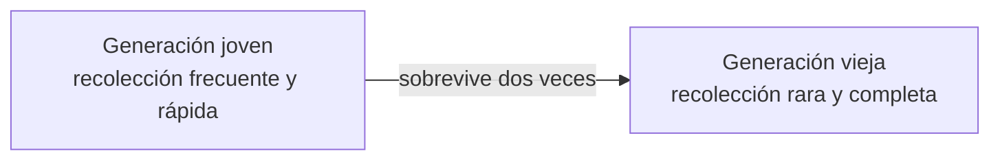

import { Quiz } from "@/components/quiz";

En lenguajes como JavaScript, Java, Python o Go, nunca liberas la memoria a mano: creas objetos y, cuando ya no los usas, desaparecen solos. De eso se encarga el **recolector de basura**: una parte del entorno de ejecución que detecta qué memoria ya no se necesita y la libera. Como resume MDN, su función es rastrear las reservas de memoria y su uso, para encontrar cuándo una parte ya no es necesaria y liberarla automáticamente.

En C, en cambio, hay que liberar cada reserva con `free`. Olvidarlo produce fugas de memoria; hacerlo dos veces o usar memoria ya liberada, fallos graves de seguridad.

## ¿Qué es basura?

Los objetos viven en el [montículo](/articulos/pila-y-monticulo-de-memoria/) y se apuntan unos a otros: forman un [grafo](/articulos/grafos/). Un objeto es **basura** cuando ya no hay forma de llegar a él desde el programa. El punto de partida son las **raíces**: las variables globales y las variables locales de las funciones que se están ejecutando.

## Primera idea: contar referencias

El algoritmo más simple lleva la cuenta de cuántas referencias apuntan a cada objeto. Cuando llega a cero, se libera. Es inmediato, pero tiene un problema que MDN señala: los **ciclos**. Si dos objetos se apuntan entre sí y nadie más los usa, cada uno tiene una referencia, y nunca se liberan.

## Marcar y barrer

La solución general es **marcar y barrer**:

1. **Marcar**: partiendo de las raíces, se siguen todos los punteros y se marca cada objeto alcanzable, recursivamente.
2. **Barrer**: todo lo que no quedó marcado es basura y se libera.

```js
const monticulo = {
	a: ["b"],
	b: ["c"],
	c: [],
	d: ["e"], // d y e se apuntan entre sí,
	e: ["d"], // pero nadie llega a ellos
	f: [],
};
const raices = ["a"];

function marcar() {
	const vivos = new Set();
	const pendientes = [...raices];
	while (pendientes.length > 0) {
		const objeto = pendientes.pop();
		if (vivos.has(objeto)) continue;
		vivos.add(objeto);
		pendientes.push(...monticulo[objeto]);
	}
	return vivos;
}

const vivos = marcar();
const basura = Object.keys(monticulo).filter((o) => !vivos.has(o));
console.log([...vivos].join(""), basura.join("")); // abc def
```

`d` y `e` forman un ciclo, pero como nadie llega a ellos desde las raíces, son basura. Marcar y barrer resuelve los ciclos que el conteo de referencias no puede. Es un recorrido de grafo, como el de [búsqueda en profundidad](/articulos/busqueda-en-anchura-y-en-profundidad/).

Tras barrer, la memoria libre queda **fragmentada** en huecos. Muchos recolectores **compactan**: mueven los objetos vivos juntos y actualizan los punteros.

## La hipótesis generacional

La mayoría de los objetos **mueren jóvenes**: se crean, se usan un momento y se abandonan, como los objetos temporales dentro de una función. El equipo de V8, el motor de JavaScript de Chrome y Node.js, la llama la **hipótesis generacional**, y explica que se cumple en la mayoría de los lenguajes dinámicos.

Así que el montículo se divide en **generaciones**:



- Los objetos nuevos nacen en la **generación joven**, que se limpia a menudo. Como casi todo está muerto, solo hay que copiar lo poco que sobrevive.
- Lo que sobrevive a varias recolecciones pasa a la **generación vieja**, que se revisa con mucha menos frecuencia.

En V8, según su blog, los objetos nacen en una zona de la generación joven, pasan a otra si sobreviven a una recolección, y a la generación vieja si sobreviven a otra más.

## Las pausas

Un recolector sencillo **detiene el programa** mientras trabaja. En una aplicación interactiva, una pausa de cien milisegundos es un tirón visible. Los recolectores modernos reducen las pausas:

- **En paralelo**: varios hilos recolectan a la vez.
- **Incremental**: el trabajo se reparte en trozos pequeños entre la ejecución del programa.
- **Concurrente**: el recolector trabaja mientras el programa sigue ejecutándose.

El proyecto Orinoco de V8 convirtió un recolector que paraba el mundo en uno mayoritariamente paralelo y concurrente.

## Las fugas siguen existiendo

Un recolector solo libera lo inalcanzable. Si el programa guarda referencias que ya no necesita, la memoria nunca se libera: una caché que crece sin límite, un manejador de eventos que nadie elimina, un temporizador que sigue vivo. Son fugas de memoria aunque haya recolector.

## Lo esencial

- El recolector libera los objetos que ya no se pueden alcanzar desde las raíces del programa.
- Contar referencias no libera los ciclos; marcar y barrer sí.
- Como casi todos los objetos mueren jóvenes, el montículo se divide en generaciones.
- Los recolectores modernos son paralelos, incrementales y concurrentes para reducir las pausas.
