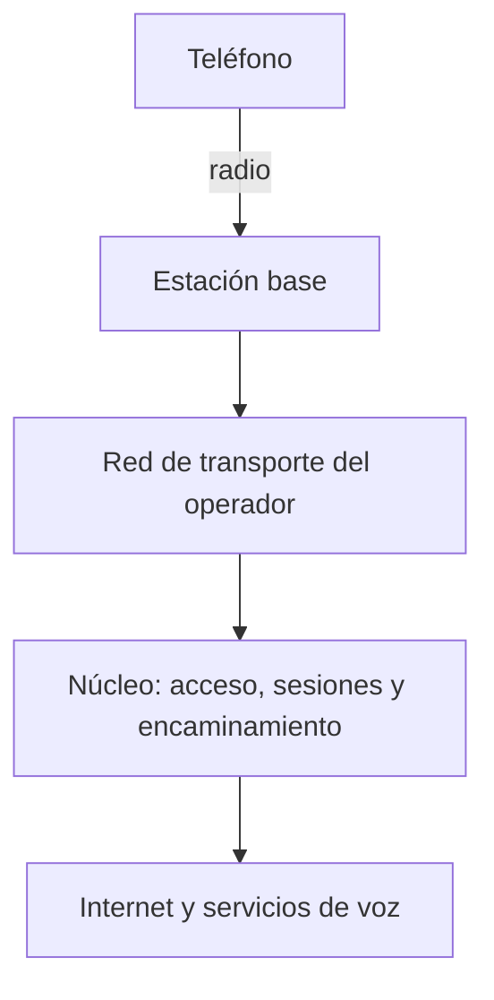

import { Quiz } from "@/components/quiz";

Una **red móvil** conecta teléfonos y otros dispositivos mediante radio a estaciones base y a la infraestructura de un operador. Divide la cobertura en **celdas** para reutilizar recursos y atender usuarios que cambian de lugar.

Una antena no conecta por sí sola con cualquier servicio: detrás necesita transporte, control de acceso y equipos que conduzcan los datos hacia su destino.

## Qué es una celda

Una **estación base** contiene equipos que transmiten, reciben y coordinan el acceso radio. Puede atender varias celdas mediante distintas antenas, sectores o frecuencias. Los hexágonos de los dibujos son un modelo: edificios, relieve, potencia y antenas producen coberturas irregulares y solapadas.

El teléfono no elige necesariamente la antena más cercana. Intervienen las medidas de señal, las frecuencias que admite, las prioridades de la red y el acceso permitido. Estar cerca de una antena de otro operador no garantiza poder usarla.



## Compartir y reutilizar recursos

La radio dispone de una banda limitada. Las redes reparten recursos de tiempo, frecuencia y, con varias antenas, espacio. En **LTE**, tecnología de la familia 4G, y en 5G, la estación programa transmisiones de los usuarios según demanda, calidad y políticas; no entrega una frecuencia exclusiva permanente a cada persona.

**Reutilizar frecuencias** permite atender otras zonas con el mismo espectro. Algunos sistemas separan las frecuencias de celdas vecinas; otros reutilizan la misma banda y deben gestionar la interferencia. Añadir estaciones puede aumentar capacidad, pero no elimina esa coordinación ni el coste de conectarlas al resto de la red.

En un modelo deliberadamente simple, si cada celda sostiene 50 comunicaciones a la calidad requerida y pueden operar simultáneamente:

```js
const comunicacionesPorCelda = 50;
const capacidadIdeal = (celdas) => celdas * comunicacionesPorCelda;
console.log(capacidadIdeal(1)); // 50
console.log(capacidadIdeal(100)); // 5000
```

La multiplicación presupone recursos y transporte suficientes, interferencias controladas y usuarios repartidos. No predice la capacidad de una red comercial. Si todos se concentran en una sola celda, las otras 99 no resuelven automáticamente su saturación.

## Un mapa que sigue descargándose al caminar

Supón que Clara ya está registrada en la red y abre un mapa:

1. Su teléfono envía datos por la celda A cuando obtiene recursos de radio. La estación los conduce al **núcleo**, la parte de la red que gestiona, entre otras funciones, sesiones y acceso a otras redes.
2. La respuesta del [servidor](/articulos/que-es-un-servidor/) vuelve por esa infraestructura hasta el teléfono. La velocidad depende también del transporte, la carga y el servidor.
3. Al caminar, el teléfono mide otras celdas y comunica resultados. La red puede preparar un **traspaso** o *handover* hacia B, usando medidas y políticas; no basta con cruzar una frontera geométrica.
4. Si B admite el traspaso y el teléfono completa el acceso, el tráfico continúa por ella. La red actualiza el recorrido de los datos y gestiona los pendientes según el procedimiento.

El objetivo es mantener la sesión con poca interrupción, no garantizar ausencia de cortes. Si no hay cobertura útil o falla el acceso a B, puede ser necesario restablecer la conexión. Una aplicación con datos almacenados puede ocultar una pausa que una llamada en directo haría perceptible.

<Quiz
	client:visible
	question="Clara tiene buena señal, pero la descarga va lenta en un estadio. ¿Qué conclusión permite ese dato?"
	options={["El servidor está necesariamente averiado", "La buena señal no descarta recursos de radio o transporte saturados", "El teléfono está conectado a la antena más lejana"]}
	answer={1}
/>

## Qué cambió entre generaciones

| Generación | Cambio característico |
| --- | --- |
| 1G | Voz analógica |
| 2G | Voz digital y mensajes; sus evoluciones también incorporaron datos por paquetes |
| 3G | Mayor capacidad para servicios de datos y acceso móvil |
| 4G | Acceso de banda ancha con red de paquetes IP; la voz puede ofrecerse sobre esa infraestructura |
| 5G | Nuevas opciones de radio y núcleo para capacidad, latencia y tipos de dispositivos distintos |

La generación describe una familia de capacidades, no una velocidad garantizada. Un despliegue 5G puede reutilizar partes de una red 4G; otro usa un núcleo 5G. El espectro, los equipos, la carga y la arquitectura condicionan las prestaciones. Una conexión 5G congestionada no tiene por qué superar una 4G con recursos disponibles.

**3GPP** desarrolla especificaciones del sistema; se creó en 1998 y su trabajo se amplió más allá de 3G. La **UIT**, Unión Internacional de Telecomunicaciones, define marcos y requisitos como IMT-2020 para 5G. La compatibilidad exige además bandas, funciones y acuerdos admitidos por equipos y operadores.

## Errores comunes

- **Tomar las barras de cobertura como un test de internet.** Resumen condiciones de radio, no todos los tramos hasta el servicio.
- **Suponer que más celdas multiplican siempre la capacidad.** Interferencia, recursos compartidos y distribución de usuarios también cuentan.
- **Interpretar handover como promesa de continuidad perfecta.** El cambio puede fallar o introducir una pausa.

## Lo esencial

- Las celdas permiten repartir cobertura y reutilizar recursos radio.
- Estación base, transporte y núcleo cumplen funciones distintas.
- Un traspaso intenta mantener el servicio al cambiar de celda; puede fallar.
- La generación y la intensidad de señal no determinan por sí solas el rendimiento.
