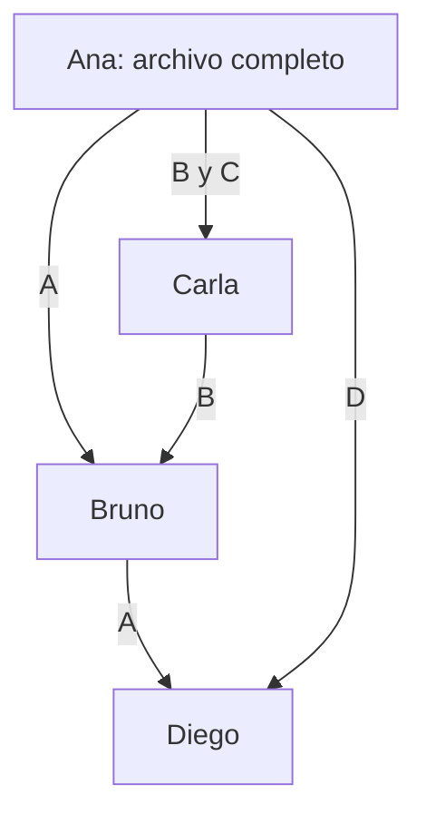

import { Quiz } from "@/components/quiz";

Una red **peer-to-peer**, **P2P** o **entre pares** organiza un servicio haciendo que sus participantes aporten recursos y se atiendan entre sí. Un participante puede pedir datos y también entregarlos: no tiene un papel fijo de consumidor o proveedor durante toda su participación.

## Qué problema resuelve

Una asociación quiere repartir un vídeo propio de 40 MB. En el [modelo cliente-servidor](/articulos/cliente-servidor/), un servidor puede enviar una copia a cada persona. Si veinte personas descargan el archivo completo directamente de él, transmite 800 MB, sin contar los mensajes de control ni retransmisiones.

En un reparto P2P, quien ya recibió una parte puede compartirla. El trabajo de subir datos se distribuye entre varios equipos. No desaparecen los bytes que hay que entregar: cambia **quién los envía** y qué capacidad aporta cada nuevo participante.

## El mismo archivo, repartido entre cuatro personas

Dividimos nuestro vídeo en cuatro bloques de 10 MB, llamados A, B, C y D. Este es un modelo sencillo de distribución por copias, no el formato exacto de un protocolo real.

Ana empieza con el vídeo completo. Bruno, Carla y Diego quieren descargarlo:

| Paso | Intercambio | Qué consigue |
| --- | --- | --- |
| 1 | Ana envía A a Bruno y B a Carla | Ya hay dos personas que pueden aportar una parte |
| 2 | Bruno envía A a Diego; Carla envía B a Bruno | Ana no tiene que realizar esas dos transferencias |
| 3 | Ana envía C a Carla | Carla puede seguir compartiendo B y empezar a compartir C |
| 4 | Ana envía D a Diego | El último bloque deja de depender exclusivamente de Ana |

Bruno puede ofrecer A mientras solicita B: actúa como proveedor en un intercambio y como consumidor en otro. El [protocolo](/articulos/que-es-un-protocolo-de-red/) coordina qué tiene cada participante, qué solicita y cómo responde.

Las flechas muestran transferencias de la aplicación. Entre dos participantes puede haber muchos [routers](/articulos/hub-switch-y-router/): P2P no significa tener un cable directo con cada persona.

## Encontrarse también requiere un mecanismo

Antes de pedir A a Bruno, Diego necesita saber que Bruno participa y cómo contactar con él. Hay varias formas de resolverlo:

- Un **índice central** mantiene referencias a los participantes o a lo que ofrecen.
- Un índice **distribuido** reparte esa información entre varios participantes.
- Los participantes pueden preguntar a vecinos y propagar consultas, según el diseño del sistema.

Por eso, **P2P no implica que no exista ningún servidor central**. Un sistema puede centralizar el descubrimiento y distribuir la transferencia de archivos. Son funciones distintas y pueden fallar por separado.

[BitTorrent](/articulos/como-funciona-bittorrent/) es un ejemplo concreto: los pares intercambian piezas y pueden descubrirse mediante un servidor de seguimiento o mediante un índice distribuido.

## Qué ocurre cuando alguien se desconecta

Volvamos al reparto. Si Ana se desconecta después del paso 3, nadie más tiene D. Los demás pueden intercambiar A, B y C, pero no completar el vídeo hasta que aparezca alguien que aporte D. Tener muchos participantes no crea los datos ausentes.

Después del paso 4 hay otra copia de D. Eso mejora la disponibilidad, pero Diego también podría desconectarse. La resistencia a fallos depende de **qué recursos están replicados y cuáles siguen accesibles**, no solo del número de equipos.

<Quiz
	client:visible
	question="Ana se desconecta antes de compartir D y ningún otro participante tiene ese bloque. ¿Qué pueden hacer los demás en este modelo?"
	options={["Completar D combinando A, B y C", "Intercambiar lo disponible y esperar una fuente de D", "Recuperar D del índice aunque solo guarde contactos"]}
	answer={1}
/>

## Ventajas y costes

P2P puede repartir almacenamiento y capacidad de envío. Encaja cuando los participantes pueden colaborar y el servicio tolera que entren y salgan. También exige descubrirlos, gestionar su disponibilidad y verificar lo que entregan.

Más participantes no garantizan más velocidad: algunos aportan poco, comparten el mismo enlace limitado o no tienen las partes necesarias. Los [cortafuegos](/articulos/cortafuegos/) y la [traducción de direcciones NAT](/articulos/que-es-nat/) también pueden dificultar conexiones directas.

Para un servicio que necesita reglas y datos gestionados por una organización, una arquitectura cliente-servidor puede simplificar el control. P2P distribuye responsabilidades; no elimina la necesidad de diseñarlas.

## Errores comunes

- **Confundir P2P con conectar todos con todos.** Un participante puede comunicarse solo con un subconjunto de pares.
- **Suponer anonimato o confidencialidad.** La arquitectura no los proporciona por sí sola; los participantes con los que te conectas pueden conocer tu dirección de red.
- **Confiar en un dato porque viene de muchos equipos.** Hace falta verificar su integridad y, cuando corresponda, su procedencia.
- **Confundir arquitectura con contenido.** Compartir entre pares sirve para distribuir archivos propios o autorizados; el mecanismo no decide qué permisos tiene un archivo.

## Lo esencial

- En P2P los participantes pueden consumir y aportar recursos.
- Descubrir participantes y transferir datos son problemas diferentes.
- Distribuir copias reduce algunas dependencias, pero una parte ausente sigue ausente.
- La disponibilidad, la velocidad y la confianza necesitan mecanismos concretos.
