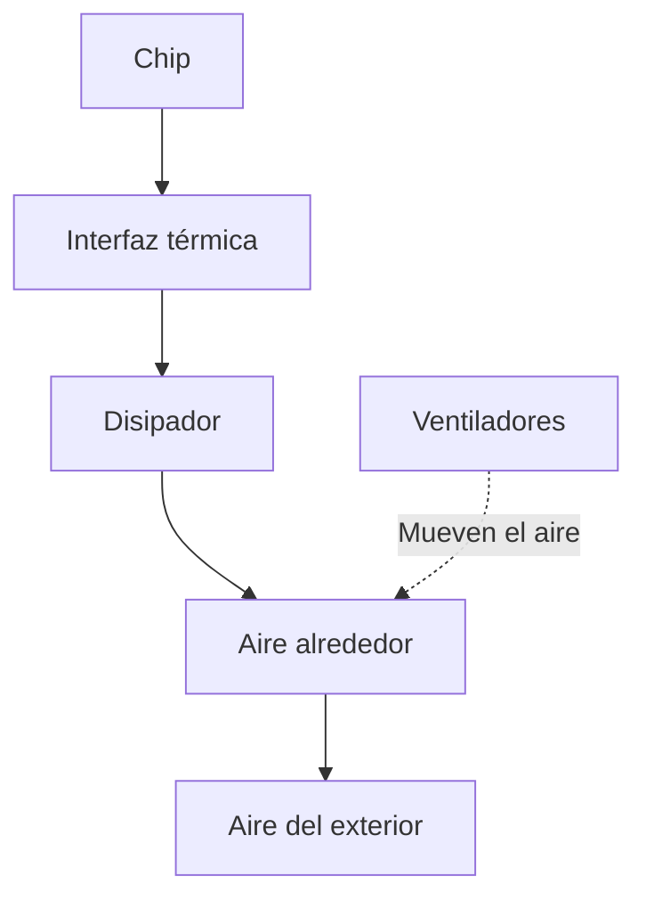

import { Quiz } from "@/components/quiz";

Un procesador convierte en **calor** prácticamente toda la energía eléctrica que consume. La refrigeración transporta ese calor hasta el entorno para mantener el chip dentro de sus condiciones de funcionamiento. No elimina la energía: la lleva a otro lugar.

Consumir 150 vatios y alcanzar 150 grados son cosas distintas. Los vatios indican la rapidez con la que se produce calor; la temperatura depende también de lo fácil que resulte evacuarlo y de la temperatura del ambiente.

## De dónde sale el calor

Al cambiar de estado, los [transistores](/articulos/que-es-un-transistor/) cargan y descargan pequeñas capacidades eléctricas: sus estructuras almacenan carga temporalmente. Ese trabajo consume energía. También hay corrientes de fuga incluso cuando no conmutan. Influyen la tensión, la frecuencia y cuántos circuitos están activos, además del diseño del chip.

Por eso el número de transistores no basta para calcular el consumo. Un chip puede dejar partes inactivas o reducir frecuencia y tensión cuando el trabajo lo permite.

## El camino hasta el aire

En un sistema de refrigeración por aire, el recorrido típico es:



La **interfaz térmica**, como una pasta o una almohadilla adecuada al montaje, rellena irregularidades entre superficies. Reduce las bolsas de aire, que dificultan la conducción. El **disipador** distribuye el calor por una pieza metálica con aletas para ofrecer más superficie al aire.

Un ventilador renueva el aire junto a esas aletas. El calor todavía debe salir de la caja: recircular aire cada vez más caliente limita el resultado aunque el ventilador gire deprisa. El polvo que obstruye el paso del aire o un mal contacto térmico dificultan distintas partes de ese recorrido.

## Un modelo para separar consumo y temperatura

Imaginemos un montaje cuya **resistencia térmica efectiva** sea de 0,4 °C por vatio: en equilibrio, cada vatio disipado mantiene el chip 0,4 °C por encima del ambiente. Son valores inventados para entender la relación, no datos de un procesador concreto.

```js
function temperaturaEstable(ambiente, potencia, resistencia) {
	return ambiente + potencia * resistencia;
}

console.log(temperaturaEstable(25, 100, 0.4)); // 65
console.log(temperaturaEstable(25, 150, 0.4)); // 85
console.log(temperaturaEstable(40, 100, 0.4)); // 80
```

Con el mismo montaje, aumentar el consumo o calentar el ambiente eleva la temperatura. En un equipo real la resistencia efectiva puede variar con el flujo de aire y el montaje, y la temperatura tarda en cambiar: este modelo solo aproxima el estado estable.

<Quiz
	client:visible
	question="En este modelo, el ambiente sube de 25 a 40 °C sin cambiar potencia ni resistencia térmica. ¿Qué ocurre?"
	options={[
		"El chip conserva su temperatura porque consume lo mismo",
		"La temperatura estable del chip sube 15 °C",
		"El chip consume necesariamente 15 W más",
	]}
	answer={1}
/>

## Aire, líquido y refrigeración pasiva

| Sistema | Cómo transporta el calor |
| --- | --- |
| Pasivo | Lo reparte por el disipador o la carcasa; el aire circula sin ventilador |
| Aire forzado | Un ventilador mueve aire por el disipador |
| Circuito líquido | Un líquido lo lleva desde un bloque hasta un radiador, que lo cede al entorno |
| Inmersión | Un líquido adecuado rodea los componentes y transporta su calor hacia un sistema de intercambio |

Un circuito líquido también necesita evacuar calor fuera del equipo. Por sí solo, no mantiene un chip activo por debajo de la temperatura del aire que enfría su radiador. Muchos móviles emplean soluciones pasivas y reparten calor por el cuerpo del dispositivo.

## Qué pasa al acercarse al límite

Los sensores permiten ajustar ventiladores y limitar el consumo. El **estrangulamiento térmico**, o *thermal throttling*, reduce el ritmo de trabajo para producir menos calor. Según el equipo, también puede haber un apagado de protección. Los límites y las respuestas dependen del componente, del fabricante y de su configuración.

En Linux, las **zonas térmicas** representan regiones cuya temperatura se vigila. Sus umbrales y políticas relacionan esas lecturas con dispositivos de refrigeración, incluidos ventiladores o mecanismos que limitan el procesador. Reducir su frecuencia no implica apagar el ventilador: las medidas pueden combinarse.

Para evitar cambios continuos cerca de un umbral, una política puede usar **histéresis**: activar una medida a cierta temperatura y retirarla a otra menor. Por ejemplo, activarla a 80 °C y retirarla al bajar de 75 °C. Son umbrales didácticos, no una configuración recomendada para cualquier equipo.

## Lo esencial

- Refrigerar significa transportar calor hasta el entorno.
- La temperatura depende del consumo, del ambiente y del recorrido térmico completo.
- Limitar el trabajo puede reducir el calor producido, pero los límites y protecciones dependen del equipo.
