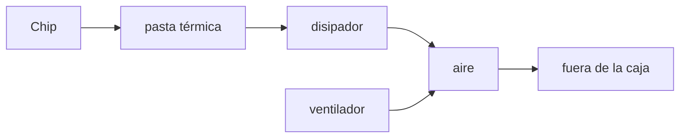

import { Quiz } from "@/components/quiz";

Un procesador o una tarjeta gráfica convierten en **calor** prácticamente toda la energía eléctrica que consumen. Un chip que consume 150 vatios produce 150 vatios de calor en una superficie de pocos centímetros cuadrados. Si ese calor no se saca, la temperatura sube en segundos hasta dañar el chip. La **refrigeración** es el sistema que lo evita.

## De dónde sale el calor

Cada vez que uno de los miles de millones de [transistores](/articulos/que-es-un-transistor/) de un chip cambia de estado, consume un poco de energía, que se disipa como calor. Cuantos más transistores y más rápido conmutan, más calor. Por eso la [frecuencia de reloj](/articulos/como-funciona-un-procesador/) no puede subir indefinidamente: llega un punto en que no hay forma práctica de sacar el calor.

## El camino del calor



1. **Pasta térmica**: rellena las imperfecciones microscópicas entre el chip y el disipador. Sin ella, quedaría aire, que conduce muy mal el calor.
2. **Disipador**: una pieza de metal, de aluminio o cobre, con muchas aletas. Recoge el calor y lo reparte en una gran superficie.
3. **Ventilador**: mueve aire entre las aletas para llevarse el calor.
4. **Flujo de la caja**: otros ventiladores renuevan el aire caliente del interior con aire fresco de fuera.

## Tipos de refrigeración

| Tipo | Cómo funciona | Dónde |
| --- | --- | --- |
| Pasiva | Solo un disipador, sin ventilador | Chips de bajo consumo, móviles |
| Por aire | Disipador y ventilador | La mayoría de ordenadores |
| Líquida | Un líquido recoge el calor y lo lleva a un radiador | Equipos potentes, algunos servidores |
| Por inmersión | Los componentes sumergidos en un líquido que no conduce la electricidad | Algunos centros de datos |

Un móvil no tiene ventilador: reparte el calor por todo su cuerpo, y por eso se calienta al usarlo mucho.

## Cuando no basta: bajar el ritmo

Los chips tienen **sensores de temperatura**. Si se acercan al límite, el procesador **reduce su frecuencia** para producir menos calor. Es el estrangulamiento térmico: el equipo sigue funcionando, pero más lento. Si aun así la temperatura sigue subiendo, se apaga para protegerse.

El sistema operativo participa. En Linux, la gestión térmica organiza el equipo en **zonas térmicas**, que son los sensores, y **dispositivos de refrigeración**, como un ventilador o el propio procesador al bajar su velocidad. Cada zona tiene **umbrales**: al superar cada uno, se activa un dispositivo, desde subir las revoluciones del ventilador hasta reducir la frecuencia.

```js
const umbrales = [
	{ temperatura: 60, accion: "ventilador al 50 %" },
	{ temperatura: 80, accion: "ventilador al 100 %" },
	{ temperatura: 95, accion: "bajar la frecuencia" },
];

const actuar = (t) =>
	umbrales.filter((u) => t >= u.temperatura).map((u) => u.accion).at(-1) ?? "nada";

console.log(actuar(45)); // "nada"
console.log(actuar(85)); // "ventilador al 100 %"
console.log(actuar(97)); // "bajar la frecuencia"
```

## En los centros de datos

En un centro de datos, la refrigeración consume una parte importante de toda la energía. Por eso se diseñan pasillos de aire frío y caliente, se aprovecha el aire exterior y se buscan emplazamientos fríos. Es una de las razones del impacto ambiental de la informática.

## Lo esencial

- Casi toda la energía que consume un chip se convierte en calor.
- El calor pasa del chip al disipador a través de la pasta térmica, y el aire o un líquido se lo lleva.
- Si la temperatura sube demasiado, el procesador baja su frecuencia o el equipo se apaga.
- El sistema operativo vigila sensores y activa la refrigeración por umbrales.
