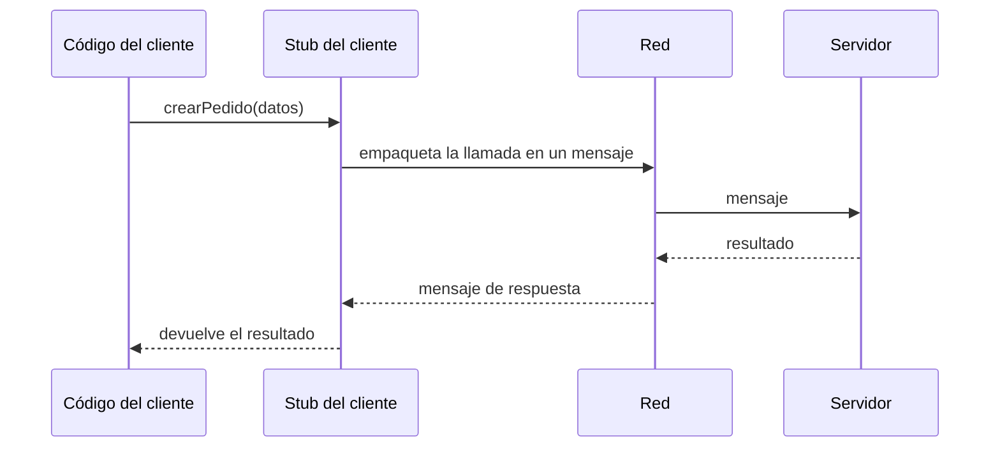

import { Quiz } from "@/components/quiz";

**RPC**, llamada a procedimiento remoto, es una forma de comunicar programas en la que uno **llama a una función que se ejecuta en otra máquina** como si fuera una función local. El programa escribe `crearPedido(datos)` y no se ocupa de la red: una capa intermedia empaqueta la llamada, la envía, espera la respuesta y la devuelve como resultado.

**gRPC** es un sistema RPC moderno, de código abierto, creado por Google. Su documentación lo resume: un cliente puede llamar directamente a un método de una aplicación servidor en otra máquina como si fuera un objeto local.

## La idea de RPC



La pieza clave es el **stub**: un objeto en el cliente con los mismos métodos que el servidor. Por fuera parece local; por dentro, convierte cada llamada en un mensaje de red. La idea es antigua: el RFC 5531 describe la versión 2 del protocolo RPC de Sun Microsystems, tal como sigue desplegado.

Un ejemplo con JSON-RPC, un protocolo RPC sencillo y sin estado que define cómo representar llamadas y respuestas en JSON:

```js
let siguienteId = 1;

function crearStub(enviar) {
	return new Proxy({}, {
		get: (_, metodo) => (...params) => enviar({ jsonrpc: "2.0", method: metodo, params, id: siguienteId++ }),
	});
}

const servidor = { sumar: (a, b) => a + b };
const red = (peticion) => {
	const resultado = servidor[peticion.method](...peticion.params);
	return { jsonrpc: "2.0", result: resultado, id: peticion.id };
};

const enviados = [];
const stub = crearStub((peticion) => {
	enviados.push(JSON.stringify(peticion));
	return red(peticion).result;
});

console.log(stub.sumar(2, 3)); // 5
console.log(enviados[0]); // {"jsonrpc":"2.0","method":"sumar","params":[2,3],"id":1}
```

El código llama a `stub.sumar(2, 3)` como a una función normal; por debajo viaja un mensaje con el nombre del método y sus parámetros.

## gRPC: el contrato primero

En gRPC, el servicio se define primero en un archivo `.proto`, con **Protocol Buffers**, el formato de Google para serializar datos estructurados:

```protobuf
syntax = "proto3";

service Pedidos {
  rpc Crear (NuevoPedido) returns (Pedido);
  rpc Seguir (PedidoId) returns (stream Estado);
}

message NuevoPedido {
  string cliente = 1;
  repeated string productos = 2;
}
```

A partir de ese archivo, una herramienta **genera el código** del cliente y del servidor en muchos lenguajes. Un servidor en Java puede tener clientes en Go, Python o Ruby, y todos comparten un contrato con tipos.

Protocol Buffers, según su documentación, es como JSON pero más pequeño y más rápido: los mensajes viajan en binario, no en texto.

## Cuatro tipos de llamada

gRPC funciona sobre [HTTP/2](/articulos/http1-http2-http3/), que permite varias peticiones simultáneas por una conexión y flujos en los dos sentidos. Eso da cuatro tipos de llamada:

| Tipo | Cliente envía | Servidor responde | Ejemplo |
| --- | --- | --- | --- |
| Unaria | Un mensaje | Un mensaje | Crear un pedido |
| Flujo del servidor | Un mensaje | Una secuencia | Seguir el estado de un pedido |
| Flujo del cliente | Una secuencia | Un mensaje | Subir lecturas de un sensor |
| Bidireccional | Una secuencia | Una secuencia | Un chat |

Además, cada llamada puede llevar un **plazo**: si no termina a tiempo, se cancela en los dos lados, en lugar de dejar recursos esperando para siempre.

## gRPC frente a REST

| | [REST](/articulos/que-es-rest/) | gRPC |
| --- | --- | --- |
| Modelo | Recursos y verbos HTTP | Funciones remotas |
| Formato | Normalmente JSON, texto legible | Protocol Buffers, binario |
| Contrato | Opcional (por ejemplo, OpenAPI) | Obligatorio, en el `.proto` |
| Flujos | Limitados | En los dos sentidos |
| Navegadores | Directo | Necesita gRPC-Web y un proxy |
| Depuración | Fácil, con cualquier herramienta | Necesita herramientas específicas |

gRPC brilla en la comunicación **entre servicios** internos, como en una arquitectura de [microservicios](/articulos/monolito-y-microservicios/): rápido, tipado y con flujos. Para APIs públicas que consumen navegadores y terceros, REST o [GraphQL](/articulos/rest-frente-a-graphql/) suelen ser más cómodos.

## El peligro de olvidar la red

RPC hace que una llamada remota parezca local, y ese es su riesgo: no lo es. Una llamada remota puede tardar, fallar a medias o no llegar. Hay que pensar en plazos, reintentos con operaciones [idempotentes](/articulos/atomicidad-e-idempotencia/) y qué hacer si el otro lado no responde, como en cualquier [sistema distribuido](/articulos/consenso-distribuido/).

## Lo esencial

- RPC permite llamar a funciones de otra máquina como si fueran locales, mediante un stub.
- gRPC define el servicio en un archivo .proto y genera el código del cliente y del servidor.
- Usa Protocol Buffers en binario y HTTP/2, con llamadas unarias y flujos en los dos sentidos.
- Encaja entre servicios internos; para APIs públicas y navegadores, REST suele ser más práctico.
