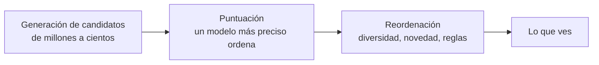

import { Quiz } from "@/components/quiz";

Las series que te propone una plataforma de vídeo, los productos que "también te pueden gustar" o las canciones de una lista automática salen de un **sistema de recomendación**: un sistema que, entre miles o millones de elementos, elige los pocos que probablemente te interesen.

## Dos ideas básicas

**Filtrado por contenido.** Recomienda elementos **parecidos** a los que te gustaron, comparando sus características: género, autor, palabras clave. Según el curso de Google, usa las características de los elementos y la interacción del propio usuario, **sin necesitar datos de otros usuarios**.

**Filtrado colaborativo.** Recomienda lo que gustó a **personas parecidas** a ti. Google subraya su ventaja: permite recomendaciones inesperadas, cosas que no se parecen a lo que ya conoces pero que gustaron a gente con tus gustos.

```js
const valoraciones = {
	ana: [5, 4, 0, 1], // puntuación de cuatro películas
	luis: [4, 5, 1, 0],
	eva: [1, 0, 5, 4],
};

const producto = (a, b) => a.reduce((s, x, i) => s + x * b[i], 0);
const coseno = (a, b) => producto(a, b) / Math.sqrt(producto(a, a) * producto(b, b));

console.log(coseno(valoraciones.ana, valoraciones.luis).toFixed(2), coseno(valoraciones.ana, valoraciones.eva).toFixed(2)); // 0.95 0.21
```

Ana se parece mucho a Luis y poco a Eva. Si Luis descubre una película nueva y le encanta, es buena candidata para Ana. Es la idea de los [vecinos más cercanos](/articulos/vecinos-mas-cercanos/) aplicada a gustos.

| | Por contenido | Colaborativo |
| --- | --- | --- |
| Se basa en | Características de los elementos | Comportamiento de otros usuarios |
| Elementos nuevos | Los recomienda desde el primer día | No, hasta que alguien interactúe con ellos |
| Sorpresas | Pocas: recomienda más de lo mismo | Sí |
| Necesita | Describir bien los elementos | Muchos usuarios e interacciones |

## Embeddings: gustos como coordenadas

Los sistemas modernos de filtrado colaborativo aprenden **[embeddings](/articulos/embeddings/)**: cada usuario y cada elemento se convierten en un vector, en un mismo espacio. Según Google, esos embeddings se aprenden solos a partir de las interacciones, sin diseñar características a mano, y la cercanía en ese espacio refleja la preferencia. El entrenamiento acerca a cada usuario a los elementos que le gustaron. Para recomendar, se buscan los elementos más cercanos al vector del usuario, a menudo con una [base de datos vectorial](/articulos/bases-de-datos-vectoriales/).

## Las tres fases

Puntuar millones de elementos para cada usuario en cada visita sería demasiado lento. El curso de Google describe un sistema típico en tres fases:



1. **Generación de candidatos**: con métodos rápidos, como los embeddings, se pasa de millones de elementos a unos cientos.
2. **Puntuación**: un modelo más costoso y preciso ordena esos candidatos.
3. **Reordenación**: se ajusta la lista final: eliminar lo ya visto, dar variedad, aplicar reglas del negocio.

## Problemas conocidos

- **Arranque en frío**: con un usuario o un elemento nuevo no hay historial del que aprender.
- **Burbujas**: recomendar solo lo parecido encierra a las personas en lo que ya conocían. La reordenación añade diversidad para compensarlo.
- **Qué se optimiza**: un sistema que solo maximiza el tiempo de uso puede priorizar contenido que engancha sobre contenido valioso, una cuestión de [sesgos](/articulos/sesgos-en-los-algoritmos/) y de ética que acompaña al [modelo de negocio](/articulos/modelos-de-negocio-digitales/).

## Lo esencial

- El filtrado por contenido recomienda lo parecido a lo que te gustó; el colaborativo, lo que gustó a gente parecida.
- Los sistemas modernos representan usuarios y elementos como embeddings en un mismo espacio.
- Suelen trabajar en tres fases: generar candidatos, puntuarlos y reordenar la lista final.
- Sufren el arranque en frío y pueden encerrar al usuario en una burbuja.
