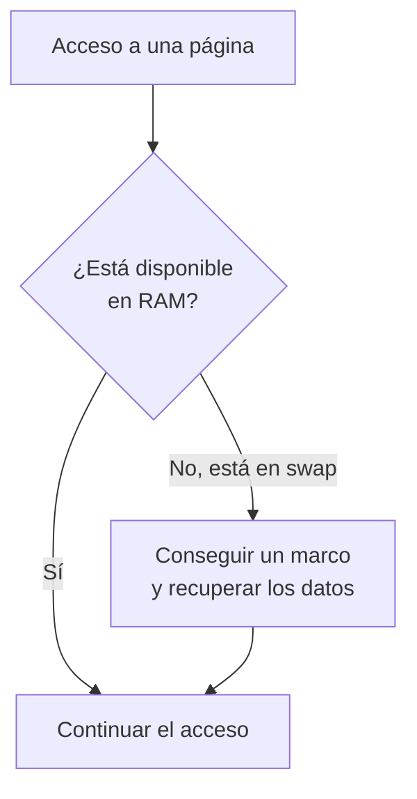

import { Quiz } from "@/components/quiz";

La **[RAM](/articulos/memoria-ram-y-almacenamiento/)** contiene los datos e instrucciones disponibles para la ejecución. El **swap**, o espacio de intercambio, permite conservar ciertas páginas de memoria fuera de sus marcos de uso directo en RAM y recuperar ese espacio. Puede apoyarse en un archivo o partición de almacenamiento; también existen dispositivos de intercambio comprimidos en RAM.

La **[memoria virtual](/articulos/memoria-virtual/)** organiza direcciones, traducción y protección. No es simplemente «RAM más swap»: un sistema puede tener memoria virtual sin disponer de intercambio.

## La misma carga con distinto espacio

Una **página** es una unidad de memoria virtual; un **marco** es el espacio físico que puede alojarla. Usaremos cuatro páginas de datos modificados, A, B, C y D. Necesitamos conservarlas, pero el programa consulta repetidamente solo A, B y C.

Con cuatro marcos disponibles para esas páginas, todas pueden permanecer en RAM. Con tres marcos y swap en disco, el sistema podría apartar D y conservar el grupo activo:

| Momento | En los tres marcos | Fuera, en swap | Qué ocurre |
| --- | --- | --- | --- |
| Tras apartar D | A, B, C | D | Se conserva D sin ocupar uno de esos marcos |
| Consultar B | A, B, C | D | B ya está disponible |
| Consultar D | A, C, D | B | En este ejemplo se aparta B y se recupera D |
| Consultar B otra vez | A, B, C | D | Elegimos apartar D y recuperar B |

La elección de víctima de la tabla es didáctica, no una regla de Linux. Omitimos cachés, páginas compartidas y otros consumos. Recuperar una página puede provocar un **fallo de página** y una espera de entrada/salida; no es un fallo del programa por sí mismo.

## Capacidad no es rendimiento

Si D permanece inactiva, tenerla en swap puede dejar espacio útil a otras tareas. Que aparezcan muchos megabytes ocupados allí no demuestra que el equipo esté intercambiando continuamente.

Si la carga consulta A, B, C y D una y otra vez con solo tres marcos, habrá que recuperar páginas repetidamente. Cuando esa actividad domina sobre el trabajo útil hablamos de **thrashing**, o intercambio excesivo. Añadir más espacio de swap permite conservar más datos, pero no añade marcos para el conjunto activo.

<Quiz
	client:visible
	question="D permanece en swap y el programa solo consulta A, B y C, residentes en RAM. ¿Qué demuestra tener swap ocupado?"
	options={["Que cada acceso está leyendo el disco", "Que hay datos conservados allí; no demuestra intercambio continuo", "Que la memoria virtual está desactivada"]}
	answer={1}
/>

| Criterio | RAM para páginas residentes | Swap en almacenamiento |
| --- | --- | --- |
| Acceso del programa | A través de sus direcciones virtuales y la jerarquía de memoria | La página debe recuperarse antes de ese acceso |
| Capacidad que aporta | Marcos para el conjunto activo | Respaldo para páginas que pueden apartarse |
| Coste | Accesos de memoria, afectados por cachés y carga | Incluye gestión y transferencia desde el dispositivo |
| Si aumenta | Puede reducir recuperaciones si faltaban marcos | No asegura acelerar una carga que intercambia continuamente |
| Conservación | La RAM habitual es volátil | No convierte la memoria de la aplicación en archivos guardados |

Un SSD reduce ciertos costes frente a un disco mecánico, pero no hace equivalente ese recorrido a disponer de la página residente.

## Qué puede liberar el sistema

No toda recuperación de RAM exige escribir swap. Una página limpia que copia datos de un archivo puede descartarse y volver a leerse desde ese archivo. Las páginas modificadas requieren conservar sus cambios por el mecanismo correspondiente; algunas páginas ni siquiera son intercambiables.

Sin swap aún pueden liberarse cachés y otros recursos. Si no se consigue memoria suficiente para una solicitud, esta puede fallar o el sistema puede terminar procesos, según sus políticas y límites. No hay una secuencia universal «RAM llena, swap lleno, matar»: también influyen límites por grupo y restricciones de la asignación.

## Intercambio comprimido y ajustes

En Linux, **zram** ofrece un dispositivo de bloques comprimido en RAM que puede usarse como swap. **zswap** es una caché comprimida para páginas destinadas a un dispositivo de intercambio de respaldo. Son organizaciones distintas. Ambas consumen RAM y CPU; su resultado depende de cuánto se compriman los datos y de la carga. No crean memoria física adicional.

El parámetro **swappiness** representa el coste relativo estimado de intercambiar páginas frente a recuperar páginas respaldadas por archivos. La documentación de Linux define valores de 0 a 200 y un valor predeterminado de 60. No es un porcentaje de RAM a llenar ni un límite de ocupación del swap. Un valor adecuado depende de dispositivos y carga; aumentarlo no prescribe por sí solo cuántos bytes se moverán.

La **hibernación** guarda un estado para reanudar tras apagar. Puede utilizar intercambio persistente, si la configuración y la capacidad lo permiten. Un dispositivo que solo vive en RAM no conserva por sí mismo esa imagen al quitar la alimentación.

## Cuándo ayuda cada uno

Si falta espacio para datos inactivos, el intercambio puede aportar margen. Si faltan marcos para el conjunto que se usa constantemente, reducir la carga o ampliar RAM puede evitar recuperaciones. Hay que observar actividad de intercambio, latencia y carga; la ocupación aislada no decide.

## Errores comunes

- **Sumar RAM y swap como si fueran la misma capacidad de trabajo.** El programa no accede de la misma forma a una página residente y a una apartada.
- **Confundir ocupación con presión actual.** Una página inactiva puede permanecer en swap sin causar nuevas esperas.
- **Usar swap como copia de seguridad.** No sustituye guardar documentos ni conservar copias independientes.

## Lo esencial

- RAM y swap cumplen funciones distintas dentro de la gestión de memoria.
- Apartar páginas puede liberar marcos; recuperarlas tiene un coste.
- La memoria virtual no exige swap ni se define como una suma de capacidades.
- El resultado depende del conjunto activo, el respaldo y la configuración.
