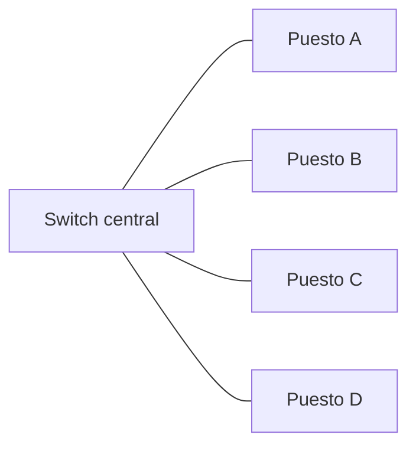
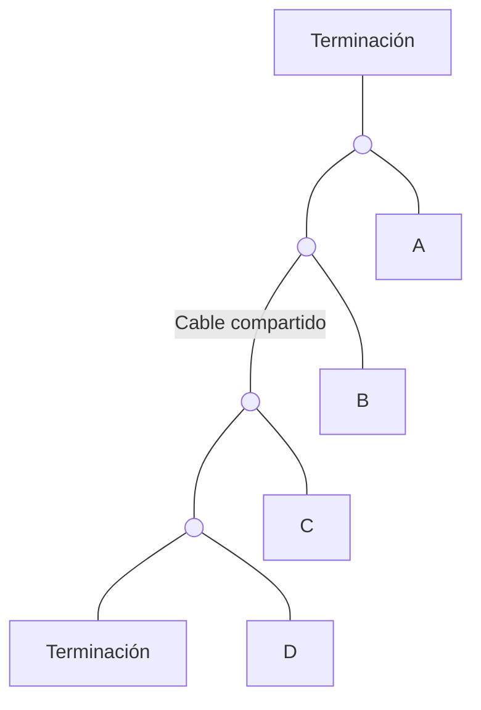
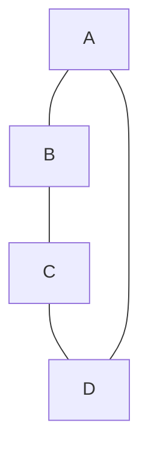
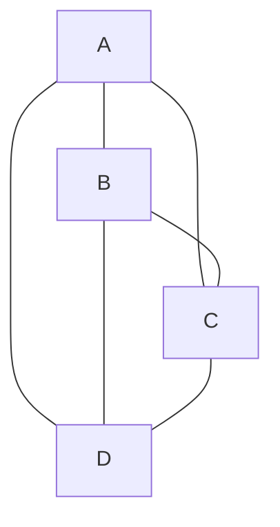

import { Quiz } from "@/components/quiz";

La **topología de una red** describe cómo están conectados sus participantes. Los **nodos** son los equipos o puntos de conexión; los **enlaces** son las conexiones que permiten intercambiar datos entre ellos.

No indica cuánto territorio cubre la red. Una [red local o LAN](/articulos/tipos-de-redes/) puede tener diferentes topologías: alcance y disposición son criterios distintos.

## Para qué sirve dibujarla

Imagina cuatro puestos de una biblioteca que comparten documentos. Un dibujo de sus conexiones permite responder preguntas concretas: ¿qué equipo intermedio necesita cada intercambio?, ¿qué deja de funcionar si se corta un cable?, ¿dónde se puede añadir otro puesto?

La forma no determina por sí sola la velocidad. También importan la capacidad de los enlaces, los equipos y las reglas que usan para transmitir. La topología muestra qué caminos y dependencias existen.

## Física y lógica

La **topología física** representa conexiones materiales, como cables y enlaces de radio. La **topología lógica** representa cómo se organiza el intercambio de datos sobre ellas.

Por ejemplo, cuatro ordenadores conectados a una caja central forman una estrella física. Si la caja es un **hub**, repite las señales hacia los demás puertos: los equipos comparten el medio lógico. Si es un **switch**, aprende dónde están los destinos y puede reenviar una trama, un bloque de datos del enlace, por el puerto correspondiente. La comparación entre [hub, switch y router](/articulos/hub-switch-y-router/) desarrolla sus diferencias.

Un mismo dibujo de cables no basta para conocer esas reglas.

## Estrella: un punto central

Cada puesto tiene su propio enlace con un equipo central. En nuestra biblioteca usamos un switch:

Para ir de A a C, los datos pasan por el switch. Si se corta el cable de A, ese puesto queda aislado, pero B, C y D conservan sus conexiones. Si falla el único switch, desaparece la comunicación entre todos ellos por esta red.

Añadir un puesto exige otro enlace y capacidad disponible en el centro. La estrella facilita localizar un cable averiado, pero concentra una dependencia importante en el equipo central.

<Quiz
	client:visible
	question="En la estrella del dibujo se corta solo el cable de A. ¿Qué consecuencia se deduce de esa topología?"
	options={["Todos los puestos quedan aislados", "A queda aislado; B, C y D mantienen sus enlaces", "El switch reconstruye el cable automáticamente"]}
	answer={1}
/>

## Bus: un medio compartido

En un **bus**, varios equipos se conectan al mismo medio de transmisión. Un ejemplo histórico es Ethernet sobre un cable coaxial compartido, un cable con conductor central y una cubierta conductora alrededor.

Los círculos marcan conexiones al **mismo cable**, no equipos que eligen salidas. Las terminaciones de sus extremos evitan que las señales se reflejen. Las señales se propagan por ese medio y los participantes necesitan reglas para compartirlo. En Ethernet compartida pueden producirse colisiones cuando transmiten a la vez.

Un fallo del cable común o de su terminación puede afectar al conjunto. Dibujar el bus como si fuera un switch ocultaría precisamente esa diferencia.

## Anillo: dos vecinos

En un **anillo**, cada nodo se conecta con dos vecinos y el último cierra el recorrido con el primero:

El dibujo muestra conexiones, no impone el sentido de transmisión. Ese comportamiento lo establece la tecnología utilizada.

Al romper B–C queda un camino físico alternativo por A y D, pero aprovecharlo exige equipos y protocolos preparados para ello. Un anillo industrial con recuperación ante fallos no se comporta igual que un anillo simple cuyo funcionamiento requiere el circuito cerrado. La redundancia física, es decir, disponer de conexiones alternativas, necesita un mecanismo que la utilice.

## Malla: varios caminos

En una **malla completa**, cada nodo se conecta directamente con todos los demás. Con cuatro nodos hay seis enlaces:

Contamos tres enlaces desde A, dos nuevos desde B y uno nuevo desde C: 3 + 2 + 1 = 6. Para n nodos son n × (n − 1) / 2: cada uno tiene n − 1 vecinos, pero contar desde ambos extremos duplica cada enlace.

Si falla A–B, existe A–C–B. Para usarlo, los nodos intermedios deben poder reenviar datos y seleccionar ese camino. La malla aporta opciones a cambio de conexiones, puertos y gestión adicionales. Una **malla parcial** incorpora solo algunas conexiones extra.

## Comparar el mismo fallo

| Disposición | Qué sucede al perder una conexión | Dependencia que hay que revisar |
| --- | --- | --- |
| Estrella | Perder el enlace de A aísla A | El equipo central y cada enlace individual |
| Bus | Dañar el medio compartido puede afectar a todos | El cable común y sus terminaciones |
| Anillo | Cambia el recorrido disponible | Si el protocolo puede recuperarse y por dónde |
| Malla | Pueden quedar caminos alternativos | Si los equipos pueden encontrarlos y utilizarlos |

## Elegir y no confundir

En una oficina, una estrella con switches permite conectar puestos de forma manejable. Entre equipos críticos puede interesar añadir conexiones alternativas. Las redes reales suelen combinar formas: estrellas locales unidas por enlaces redundantes, por ejemplo.

**Más cables no garantizan más disponibilidad.** Si todos dependen de la misma alimentación o atraviesan la misma canalización, un solo fallo puede afectar a varios. Y añadir bucles sin configurar los mecanismos adecuados puede provocar problemas de circulación del tráfico.

Tampoco [P2P](/articulos/redes-peer-to-peer/) equivale a una malla física: describe cómo colaboran programas, que pueden comunicarse sobre la estrella de tu casa y las redes de varios operadores.

## Lo esencial

- La topología describe nodos, enlaces y caminos; el alcance describe otra propiedad.
- La disposición física y el intercambio lógico pueden diferir.
- Estrella, bus, anillo y malla tienen dependencias y costes distintos.
- Un camino alternativo solo ayuda si existe un mecanismo capaz de utilizarlo.
