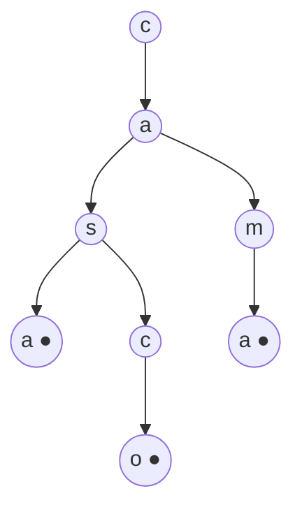

import { Quiz } from "@/components/quiz";

Un **trie**, también llamado **árbol de prefijos**, es un árbol en el que cada nodo representa una letra, y cada palabra es un camino desde la raíz. Las palabras que empiezan igual comparten los primeros nodos. Eso permite encontrar muy deprisa todas las palabras que empiezan por un prefijo dado.

El nombre viene de *retrieval*, recuperación. Se pronuncia como *tree* o como *try*, según a quién se pregunte.

## La idea

Las palabras "casa", "casco" y "cama":



El punto marca dónde termina una palabra. "Casa" y "casco" comparten "cas"; las tres comparten "ca".

## Un ejemplo

```js
const crearNodo = () => ({ hijos: {}, fin: false });

function insertar(raiz, palabra) {
	let nodo = raiz;

	for (const letra of palabra) {
		nodo.hijos[letra] ??= crearNodo();
		nodo = nodo.hijos[letra];
	}

	nodo.fin = true;
}

function conPrefijo(raiz, prefijo) {
	let nodo = raiz;

	for (const letra of prefijo) {
		nodo = nodo.hijos[letra];
		if (!nodo) return [];
	}

	const resultado = [];
	const recorrer = (actual, texto) => {
		if (actual.fin) resultado.push(texto);
		const hijos = Object.entries(actual.hijos).sort(([a], [b]) =>
			a < b ? -1 : a > b ? 1 : 0,
		);
		for (const [letra, hijo] of hijos) {
			recorrer(hijo, texto + letra);
		}
	};
	recorrer(nodo, prefijo);

	return resultado;
}

const raiz = crearNodo();
for (const palabra of ["casa", "casco", "cama", "perro"]) {
	insertar(raiz, palabra);
}

console.log(conPrefijo(raiz, "cas").join(" ")); // "casa casco"
console.log(conPrefijo(raiz, "ca").join(" ")); // "cama casa casco"
console.log(conPrefijo(raiz, "x").length); // 0
```

Para encontrar las palabras que empiezan por "cas", se baja tres niveles y se recorre lo que cuelga de ahí. El resto del diccionario no se toca. El ejemplo ordena los hijos para producir un orden lexicográfico de JavaScript; no aplica las reglas lingüísticas de un idioma. Sin esa ordenación, los hijos del objeto seguirían su orden de enumeración. `fin` distingue una palabra completa de un prefijo: guardar «casa» no implica haber guardado «cas».

## Cuánto cuesta

Localizar una palabra de longitud L requiere O(L) accesos a hijos, suponiendo que cada acceso tiene coste constante. «Casa» tiene cuatro pasos. Devolver todas las palabras de un prefijo cuesta además recorrer sus descendientes y construir los resultados: un prefijo frecuente puede producir millones de palabras.

| Operación | Trie | [Tabla hash](/articulos/tablas-hash/) | [Árbol equilibrado](/articulos/arboles-equilibrados/) |
| --- | --- | --- | --- |
| Buscar una palabra | O(L) accesos | Calcular hash O(L), más búsqueda esperada O(1) | O(log n) comparaciones; comparar cadenas también cuesta |
| Todas las que empiezan por un prefijo | Localizar prefijo y recorrer resultados | Habitualmente hay que recorrer todo | Posible, con un rango |
| Recorrer en orden de claves | Ordenando los hijos | No por sí sola | Sí, según su comparador |
| Memoria | Alta | Media | Media |

Una tabla hash suele ser una buena opción para igualdad exacta, pero cuál es más rápida depende de las claves y la representación. El trie ofrece una ventaja estructural cuando importan los **prefijos**: permite descartar ramas que no pueden contener resultados.

## Dónde se usa

- **Autocompletar**: sugerencias mientras se escribe en un buscador o en el teclado del móvil.
- **Correctores ortográficos**.
- **[Enrutamiento](/articulos/enrutamiento/)**: los routers buscan el prefijo más largo de una dirección IP que coincide con su tabla, con estructuras de este tipo.
- **Rutas de una aplicación web**: muchos frameworks localizan qué código atiende `/productos/42` con un árbol de prefijos.
- **Diccionarios** en juegos de palabras.

## El inconveniente: la memoria

Cada letra es un nodo, con sus enlaces. Un trie con muchas palabras ocupa bastante más que la lista de palabras.

La variante **comprimida**, o árbol radix, une en un solo nodo las cadenas de letras sin bifurcaciones: en el ejemplo, "c" y "a" serían un único nodo "ca". Ocupa mucho menos.

<Quiz
	client:visible
	question="¿Qué operación hace especialmente bien un trie?"
	options={[
		"Ordenar números",
		"Encontrar todas las palabras que empiezan por un prefijo",
		"Calcular la media de unos valores",
	]}
	answer={1}
/>

## Lo esencial

- Un trie guarda palabras letra a letra, y las que empiezan igual comparten camino.
- Buscar cuesta según la longitud de la palabra, no según cuántas hay.
- Es ideal para buscar por prefijo: autocompletar, correctores, rutas.
- Consume mucha memoria; las versiones comprimidas lo reducen.
