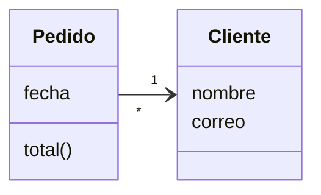
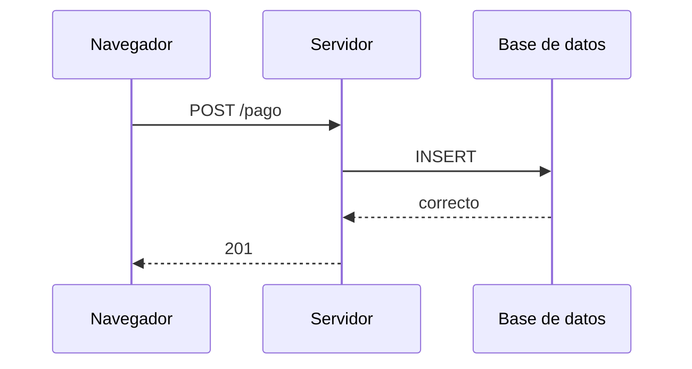

import { Quiz } from "@/components/quiz";

**UML**, lenguaje unificado de modelado, es un estándar de diagramas para describir el diseño de un sistema de software: qué piezas tiene, cómo se relacionan y cómo se comportan. Lo mantiene la organización OMG, y define una notación común para que cualquiera que conozca UML entienda un diagrama.

## Para qué sirve

- **Pensar antes de programar**: dibujar la estructura ayuda a detectar problemas de diseño.
- **Comunicar** el diseño a otras personas.
- **Documentar** un sistema existente.

UML no es un lenguaje de programación. Es una forma de dibujar ideas sobre el software.

## Dos familias de diagramas

UML define más de una docena de diagramas, en dos grupos:

- **Estructurales**: cómo es el sistema.
- **De comportamiento**: qué hace y cómo cambia.

En la práctica se usan unos pocos.

### Diagrama de clases

Muestra las [clases](/articulos/que-es-una-clase/), sus atributos y métodos, y cómo se relacionan: herencia, composición, asociación.

Un cliente tiene muchos pedidos; cada pedido es de un cliente. Es primo del [modelo entidad-relación](/articulos/modelo-entidad-relacion/), centrado en objetos en lugar de en tablas.

### Diagrama de secuencia

Muestra cómo se comunican varias partes a lo largo del tiempo: quién llama a quién y en qué orden.

Es el más útil para explicar un flujo, como el de un inicio de sesión con [OAuth](/articulos/oauth-2-y-openid-connect/).

### Diagrama de casos de uso

Muestra qué pueden hacer los distintos tipos de usuario con el sistema. Ayuda a reunir los [requisitos](/articulos/requisitos-funcionales-y-no-funcionales/).

### Diagrama de estados

Muestra los estados por los que pasa algo y qué los cambia: un pedido pendiente, pagado, enviado, entregado. Es una [máquina de estados](/articulos/circuitos-secuenciales-y-biestables/) dibujada.

### Diagrama de actividad

Un diagrama de flujo: los pasos de un proceso, con decisiones y caminos en paralelo.

## Cuánto usarlo

UML tuvo una época en la que se intentaba diseñar todo el sistema en diagramas detallados antes de escribir código, e incluso generar el código a partir de ellos. Con los [métodos ágiles](/articulos/scrum-y-metodologias-agiles/) eso perdió fuerza.

Hoy se usa de forma más ligera: un diagrama de secuencia en la documentación, un diagrama de clases en una pizarra para discutir un diseño. Lo valioso es la notación compartida, no el diagrama exhaustivo.

<Quiz
	client:visible
	question="¿Qué diagrama UML muestra el orden en que se comunican varias partes de un sistema?"
	options={["Diagrama de clases", "Diagrama de secuencia", "Diagrama de casos de uso"]}
	answer={1}
/>

## Lo esencial

- UML es un lenguaje gráfico estándar para describir el diseño de un software.
- Los diagramas estructurales muestran cómo es el sistema; los de comportamiento, qué hace.
- Los más usados son los de clases, secuencia, casos de uso y estados.
- Hoy se usa de forma ligera, para pensar y comunicar.
