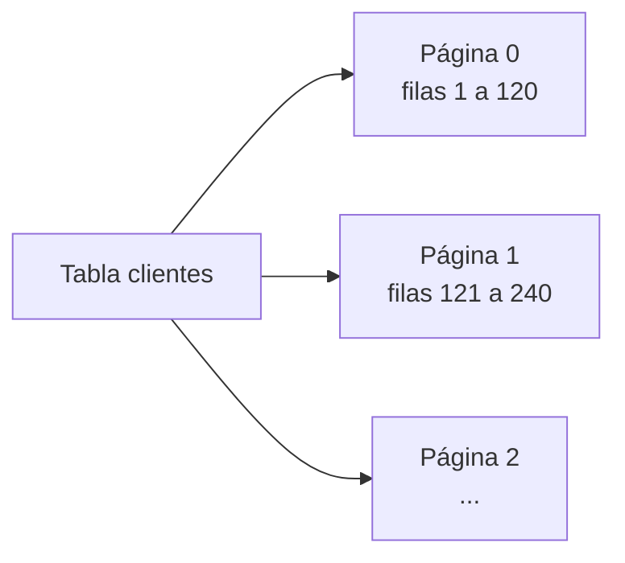
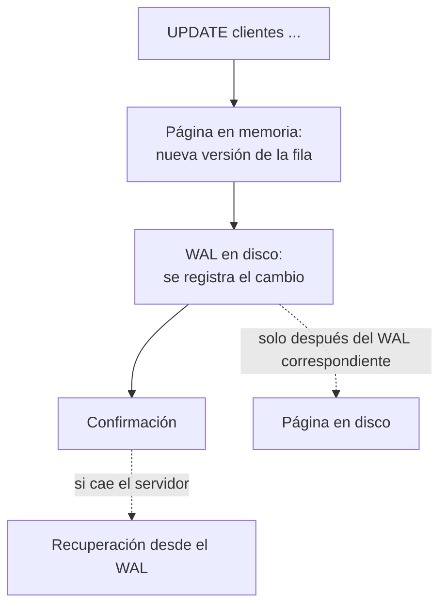

import { Quiz } from "@/components/quiz";

Desde fuera, una base de datos relacional es una caja que recibe [SQL](/articulos/que-es-sql/) y devuelve filas. Por dentro, resuelve problemas difíciles: guardar los datos de forma que se encuentren rápido, no perder nada si se va la luz y dejar que muchas personas lean y escriban a la vez sin pisarse. Este artículo recorre las tres piezas que lo hacen posible, con [PostgreSQL](/articulos/que-es-postgresql/) como ejemplo.

## Páginas: la unidad de todo

Una base de datos no lee filas sueltas del disco: lee **páginas**, bloques de tamaño fijo. Según la documentación de PostgreSQL, cada tabla e índice se guarda como una secuencia de páginas de normalmente **8 kB**, y en una tabla cada fila puede estar en cualquiera de ellas.



Las páginas que se usan se guardan en memoria, en una [caché](/articulos/que-es-una-cache/) de la propia base de datos. Leer del disco es caro, así que todo el diseño intenta tocar las menos páginas posibles. Un [índice](/articulos/indices-de-bases-de-datos/), normalmente un [árbol B](/articulos/arboles-b/), sirve exactamente para eso: llegar a la página que contiene la fila buscada sin recorrer la tabla entera.

## WAL: escribir antes en el diario

Si la base de datos modificara directamente las páginas en el disco y se fuera la luz a mitad, quedarían datos a medias. La solución es el **registro de escritura anticipada** (*write-ahead log*, WAL). La documentación de PostgreSQL resume su idea central: los cambios en los archivos de datos solo se escriben **después** de haber registrado en el WAL, en almacenamiento permanente, una descripción de esos cambios.

1. Durante las modificaciones de páginas **en memoria**, se generan registros WAL.
2. Antes de escribir una página modificada en almacenamiento persistente, debe haberse persistido su WAL correspondiente.
3. Con confirmación síncrona, antes de responder que la transacción está confirmada se fuerza el WAL necesario, incluido su registro de confirmación. No hace falta esperar a escribir todas las páginas de datos.
4. Tras una caída, la recuperación **rehace** los cambios necesarios desde el WAL y respeta el estado de confirmación de las transacciones al determinar qué datos son visibles.

El orden recuerda al de un [sistema de archivos con registro](/articulos/sistema-de-archivos-con-registro/). La escritura secuencial del WAL permite agrupar trabajo y evita forzar cada página para confirmar. La garantía depende de la configuración y de que el almacenamiento respete la sincronización.

Para recuperar un punto pasado necesitas una **copia base** válida y una secuencia continua de WAL archivado que cubra desde esa copia hasta el objetivo. Guardar solo el WAL no permite reconstruir cualquier fecha ni recuperar segmentos perdidos.

## MVCC: varias versiones de cada fila

¿Qué pasa si alguien lee una fila mientras otro la modifica? PostgreSQL usa **control de concurrencia multiversión** (MVCC): una lectura ordinaria observa versiones visibles para su **instantánea**. Así no necesita esperar a que termine una actualización de esa fila. Siguen existiendo bloqueos: por ejemplo, escrituras concurrentes, lecturas que piden bloqueo explícito y cambios de esquema pueden esperar.

La idea: un `UPDATE` crea una **versión nueva** y registra la sustitución de la anterior. Para ver el mecanismo, este modelo usa números como momentos lógicos de confirmación. No simula las reglas reales de visibilidad de PostgreSQL, que también consideran transacciones activas y abortadas:

```js
const versiones = [
	{ saldo: 100, creada: 10, borrada: 20 },
	{ saldo: 70, creada: 20, borrada: null },
];

const visible = (v, instantanea) => v.creada <= instantanea && (v.borrada === null || v.borrada > instantanea);
const leer = (instantanea) => versiones.filter((v) => visible(v, instantanea)).map((v) => v.saldo).join();

console.log(leer(15), leer(25)); // 100 70
```

Una instantánea del momento 15 ve 100; una del 25 ve 70. Cuándo se renueva depende del [nivel de aislamiento](/articulos/niveles-de-aislamiento/): en Read Committed de PostgreSQL hay una nueva por sentencia; en Repeatable Read se conserva durante la transacción. Los números de transacción reales no son marcas temporales intercambiables con los de esta simulación.

El coste: las versiones viejas se acumulan. Cuando ninguna transacción puede verlas ya, hay que limpiarlas. En PostgreSQL lo hace el proceso de **vacuum**, una especie de [recolección de basura](/articulos/recoleccion-de-basura/) de filas.

## Juntas



La página puede llegar al disco antes o después de la confirmación: la condición imprescindible es que su WAL correspondiente llegue primero.

<Quiz
	client:visible
	question="Hay una copia base, pero falta un segmento de WAL entre ella y el punto al que quieres restaurar. ¿Basta con conservar los segmentos posteriores?"
	options={["Sí, el último segmento contiene toda la base", "No: la recuperación necesita la secuencia de cambios que cubre ese intervalo", "Sí, si las tablas tienen índices"]}
	answer={1}
/>

## Errores comunes

- **Confundir una instantánea con una copia física de toda la base.** Es una regla de visibilidad sobre versiones; no exige copiar todos los datos por lector.
- **Suponer que MVCC elimina cualquier espera.** Las versiones reducen conflictos entre lecturas ordinarias y escrituras, pero no sustituyen toda coordinación.
- **Usar WAL como única copia de seguridad.** La recuperación a un punto requiere también una base de partida y continuidad del registro.

## Lo esencial

- Las bases de datos leen y escriben páginas de tamaño fijo, y cachean en memoria las que usan.
- El WAL correspondiente debe persistirse antes que una página modificada; puede bastar para confirmar sin forzar todas las páginas.
- MVCC permite leer versiones compatibles con una instantánea y reduce bloqueos entre lecturas ordinarias y escrituras.
- Las versiones viejas se limpian después, con procesos como el vacuum de PostgreSQL.
