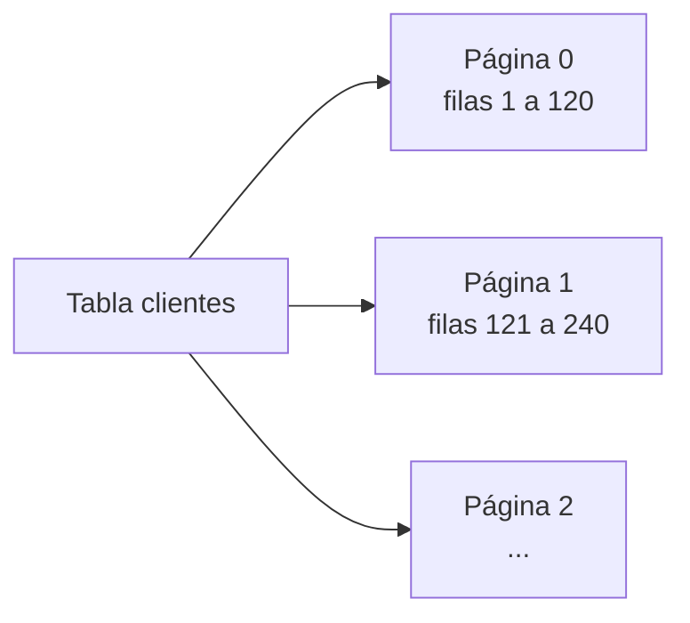
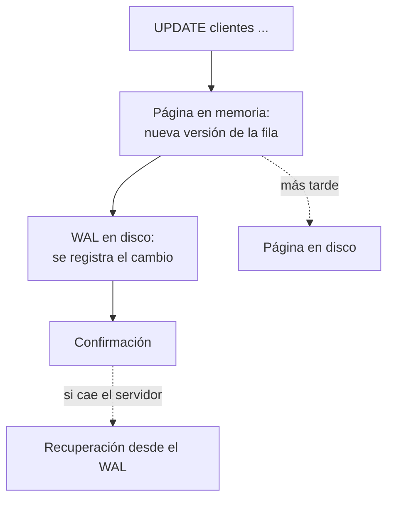

import { Quiz } from "@/components/quiz";

Desde fuera, una base de datos relacional es una caja que recibe [SQL](/articulos/que-es-sql/) y devuelve filas. Por dentro, resuelve problemas difíciles: guardar los datos de forma que se encuentren rápido, no perder nada si se va la luz y dejar que muchas personas lean y escriban a la vez sin pisarse. Este artículo recorre las tres piezas que lo hacen posible, con [PostgreSQL](/articulos/que-es-postgresql/) como ejemplo.

## Páginas: la unidad de todo

Una base de datos no lee filas sueltas del disco: lee **páginas**, bloques de tamaño fijo. Según la documentación de PostgreSQL, cada tabla e índice se guarda como una secuencia de páginas de normalmente **8 kB**, y en una tabla cada fila puede estar en cualquiera de ellas.



Las páginas que se usan se guardan en memoria, en una [caché](/articulos/que-es-una-cache/) de la propia base de datos. Leer del disco es caro, así que todo el diseño intenta tocar las menos páginas posibles. Un [índice](/articulos/indices-de-bases-de-datos/), normalmente un [árbol B](/articulos/arboles-b/), sirve exactamente para eso: llegar a la página que contiene la fila buscada sin recorrer la tabla entera.

## WAL: escribir antes en el diario

Si la base de datos modificara directamente las páginas en el disco y se fuera la luz a mitad, quedarían datos a medias. La solución es el **registro de escritura anticipada** (*write-ahead log*, WAL). La documentación de PostgreSQL resume su idea central: los cambios en los archivos de datos solo se escriben **después** de haber registrado en el WAL, en almacenamiento permanente, una descripción de esos cambios.

1. Una transacción modifica páginas **en memoria**.
2. Antes de confirmarla, sus cambios se apuntan en el WAL y este se fuerza al disco.
3. La transacción se considera confirmada. Las páginas modificadas se escribirán más tarde, con calma.
4. Si el servidor cae, al arrancar **rehace** desde el WAL todo lo confirmado que no llegó a las páginas.

Es la misma idea que un [sistema de archivos con registro](/articulos/sistema-de-archivos-con-registro/), y da la durabilidad de [ACID](/articulos/transacciones-y-acid/). Además, es más rápido: el WAL se escribe **secuencialmente**, y basta con forzar al disco ese archivo, no cada página tocada. Con muchas transacciones pequeñas, una sola escritura del WAL puede confirmar varias a la vez. Y guardando el WAL se puede restaurar la base de datos a cualquier instante pasado.

## MVCC: varias versiones de cada fila

¿Qué pasa si alguien lee una fila mientras otro la está modificando? Con cerrojos, uno esperaría al otro. PostgreSQL usa **control de concurrencia multiversión** (MVCC): según su documentación, cada sentencia ve una **instantánea** de los datos tal como estaban en un momento dado, y así **leer nunca bloquea a escribir, ni escribir a leer**.

La idea: un `UPDATE` no sobrescribe la fila. Crea una **versión nueva** y marca la anterior como sustituida, cada una con el número de la transacción que la creó y la que la borró. Cada transacción ve solo las versiones que estaban vigentes en su instantánea:

```js
const versiones = [
	{ saldo: 100, creada: 10, borrada: 20 },
	{ saldo: 70, creada: 20, borrada: null },
];

const visible = (v, instantanea) => v.creada <= instantanea && (v.borrada === null || v.borrada > instantanea);
const leer = (instantanea) => versiones.filter((v) => visible(v, instantanea)).map((v) => v.saldo).join();

console.log(leer(15), leer(25)); // 100 70
```

Una transacción que empezó en el momento 15 sigue viendo un saldo de 100, aunque la transacción 20 ya lo haya cambiado a 70. Una que empieza en el 25 ve el 70. Ninguna espera a la otra. Así se implementan los [niveles de aislamiento](/articulos/transacciones-y-acid/).

El coste: las versiones viejas se acumulan. Cuando ninguna transacción puede verlas ya, hay que limpiarlas. En PostgreSQL lo hace el proceso de **vacuum**, una especie de [recolección de basura](/articulos/recoleccion-de-basura/) de filas.

## Juntas



## Lo esencial

- Las bases de datos leen y escriben páginas de tamaño fijo, y cachean en memoria las que usan.
- El WAL registra cada cambio antes de aplicarlo: permite recuperarse de una caída y confirmar rápido.
- MVCC guarda varias versiones de cada fila para que leer y escribir no se bloqueen.
- Las versiones viejas se limpian después, con procesos como el vacuum de PostgreSQL.
